<h1 align="center">Eden Duo Companions</h1>

<p align="center">
  Second-screen companions for <a href="https://github.com/igawa6/eden-duo">Eden Duo</a>, one installable package per game.
</p>

<div align="center">
  <a href="https://discord.gg/r6vBWKAqCK"></a>&nbsp;<a href="https://ko-fi.com/igawa6"></a>&nbsp;<a href="https://ko-fi.com/polls/5th-Poll-Next-Switch-Game-on-Eden-Duo-Y2S729BJ48"></a>
</div>

---

A companion turns the second screen of a dual-screen Android handheld into a live, touchable panel for the game you are playing: maps, menus, status and more, read from the running game. Each companion ships as a `.dsmod.zip` package and is installed from the game's **Add-ons** menu in Eden Duo.

This repository holds the companion source code, packages, documentation and screenshots. The emulator itself lives in [Eden Duo](https://github.com/igawa6/eden-duo).

## Supported Games

| No | Game | Title ID | Patch Version | Download | Contributor/<br>Supporter |
|---:|------|----------|---------------|----------|:---------:|
| 1 | [Persona 5 Royal](#persona-5-royal) | `01005CA01580E000` | 1.0.2 | [.dsmod.zip](https://github.com/igawa6/eden-duo-companions/releases/tag/persona5royal-1.1.0) | 🥇<br><a href="https://www.reddit.com/user/gymgooner123"></a> |
| 2 | [Metroid Dread](#metroid-dread) | `010093801237C000` | 2.1.0 | [.dsmod.zip](https://github.com/igawa6/eden-duo-companions/releases/tag/metroid-dread-1.0.0) | |
| 3 | [The Legend of Zelda: Link's Awakening](#the-legend-of-zelda-links-awakening) | `01006BB00C6F0000` | 1.0.1 | [.dsmod.zip](https://github.com/igawa6/eden-duo-companions/releases/tag/links-awakening-1.0.0) | |
| 4 | [Mario Kart 8 Deluxe](#mario-kart-8-deluxe) (also with CTGP-DX v1.1.1) | `0100152000022000` | 4.0.1, 4.0.0, 3.0.3 | [.dsmod.zip](https://github.com/igawa6/eden-duo-companions/releases/tag/mario-kart-8-deluxe-1.0.1) | |
| 5 | [Super Mario Bros. Wonder](#super-mario-bros-wonder) | `010015100B514000` | 1.2.1 | [.dsmod.zip](https://github.com/igawa6/eden-duo-companions/releases/tag/super-mario-bros-wonder-1.0.2) | ⭐<br><a href="https://www.patreon.com/cw/KalebPowell"></a> |
| 6 | [Animal Crossing: New Horizons](#animal-crossing-new-horizons) | `01006F8002326000` | 3.0.3 | [.dsmod.zip](https://github.com/igawa6/eden-duo-companions/releases/tag/animal-crossing-new-horizons-1.0.0) | 🥇<br><a href="https://ko-fi.com/W5J3253HW9"></a> |
| 7 | [Fire Emblem: Three Houses](#fire-emblem-three-houses) | `010055D009F78000` | 1.2.0 | [.dsmod.zip](https://github.com/igawa6/eden-duo-companions/releases/tag/fire-emblem-three-houses-1.0.0) | |
| 8 | [The Binding of Isaac: Afterbirth+ and Repentance DLC](#the-binding-of-isaac-afterbirth-and-repentance-dlc) | `010021C000B6A000` | 1.7.9b | [.dsmod.zip](https://github.com/igawa6/eden-duo-companions/releases/tag/the-binding-of-isaac-1.0.2) | 🥇<br><a href="https://ko-fi.com/U3I527XBIL"></a> |
| 9 | [Pokémon Brilliant Diamond / Luminescent Platinum](#pokemon-brilliant-diamond-luminescent-platinum) | `0100000011D90000` | 1.3.0 (vanilla or Luminescent Platinum 2.2F) | [.dsmod.zip](https://github.com/igawa6/eden-duo-companions/releases/tag/pokemon-luminescent-platinum-1.0.0) | 🗳️<br><a href="https://ko-fi.com/polls/Next-Switch-Game-on-Eden-Duo-M0V127VUYA"></a> |
| 10 | [Pokémon Shining Pearl / Luminescent Platinum](#pokemon-shining-pearl-luminescent-platinum) | `010018E011D92000` | 1.3.0 (vanilla or Luminescent Platinum 2.2F) | [.dsmod.zip](https://github.com/igawa6/eden-duo-companions/releases/tag/pokemon-shining-pearl-1.0.0) | 🗳️<br><a href="https://ko-fi.com/polls/Next-Switch-Game-on-Eden-Duo-M0V127VUYA"></a> |
| 11 | [Crash Team Racing Nitro-Fueled](#crash-team-racing-nitro-fueled) | `0100F9F00C696000` | 1.0.15 | [.dsmod.zip](https://github.com/igawa6/eden-duo-companions/releases/tag/crash-team-racing-nitro-fueled-1.0.0) | |
| 12 | [Dragon Quest III HD-2D Remake](#dragon-quest-iii-hd-2d-remake) | `01003E601E324000` | 1.1.0.0 | [.dsmod.zip](https://github.com/igawa6/eden-duo-companions/releases/tag/dragon-quest-iii-hd-2d-remake-1.0.0) | 🥇<br><a href="https://ko-fi.com/G0I027XSOG"></a> |
| 13 | [Chained Echoes](#chained-echoes) | `0100C510166F0000` | 1.41 | [.dsmod.zip](https://github.com/igawa6/eden-duo-companions/releases/tag/chained-echoes-1.0.0) | 🥇<br><a href="https://ko-fi.com/U7U31RLL6S"></a> |
| 14 | [Yoru Tomosu](#yoru-tomosu) | `0100C2901153C000` | 1.0.0 | [.dsmod.zip](https://github.com/igawa6/eden-duo-companions/releases/tag/yoru-tomosu-1.0.0) | 🥇<br><a href="https://ko-fi.com/igawa6/commissions"></a> |
| 15 | [Diablo III: Eternal Collection](#diablo-iii-eternal-collection) | `01001B300B9BE000` | 2.7.7, 2.7.6 | [.dsmod.zip](https://github.com/igawa6/eden-duo-companions/releases/tag/diablo-iii-eternal-collection-1.0.0) | 🥇<br><a href="https://ko-fi.com/Z2B723BQK6"></a> |
| 16 | [Farming Simulator: Nintendo Switch Edition](#farming-simulator-nintendo-switch-edition) | `0100D04004176000` | 1.5.0.1 | [.dsmod.zip](https://github.com/igawa6/eden-duo-companions/releases/tag/farming-simulator-nintendo-switch-edition-1.0.1) | 🥇<br><a href="https://ko-fi.com/igawa6/commissions"></a> |
| 17 | [VA-11 Hall-A: Cyberpunk Bartender Action](#va-11-hall-a-cyberpunk-bartender-action) | `010086500D3C8000` | 1.0.0 | [.dsmod.zip](https://github.com/igawa6/eden-duo-companions/releases/tag/va-11-hall-a-1.0.0) | ⭐<br><a href="https://ko-fi.com/matinc"></a> |
| 18 | [The Legend of Zelda: Breath of the Wild](#the-legend-of-zelda-breath-of-the-wild) | `01007EF00011E000` | 1.6.0 | [.dsmod.zip](https://github.com/igawa6/eden-duo-companions/releases/tag/breath-of-the-wild-1.0.0) | 🗳️<br><a href="https://ko-fi.com/polls/2nd-Poll-Next-Switch-Game-on-Eden-Duo-Q6B3284653"></a> |
| 19 | [Castlevania: Belmont's Curse](#castlevania-belmonts-curse) | `0100BA4026E94000` | 1.1.0 | [.dsmod.zip](https://github.com/igawa6/eden-duo-companions/releases/tag/castlevania-belmonts-curse-1.0.0) | 🥇<br><a href="https://www.reddit.com/user/gymgooner123"></a> |
| 20 | [Super Mario Odyssey](#super-mario-odyssey) | `0100000000010000` | 1.4.1 | [.dsmod.zip](https://github.com/igawa6/eden-duo-companions/releases/tag/super-mario-odyssey-1.0.0) | 🥈<br><a href="https://ko-fi.com/s/9e92af191b"></a> |
| 21 | [The Legend of Zelda: Echoes of Wisdom](#the-legend-of-zelda-echoes-of-wisdom) | `01008CF01BAAC000` | 1.1.0 | [.dsmod.zip](https://github.com/igawa6/eden-duo-companions/releases/tag/echoes-of-wisdom-1.0.0) | 🗳️<br><a href="https://ko-fi.com/polls/3rd-Poll-Next-Switch-Game-on-Eden-Duo-C7J128KB48"></a> |
| 22 | [Dave the Diver](#dave-the-diver) | `010097F018538000` | 1.0.6.1267 | [.dsmod.zip](https://github.com/igawa6/eden-duo-companions/releases/tag/dave-the-diver-1.0.0) | ⭐<br><a href="https://discord.gg/r6vBWKAqCK"></a> |
| 23 | [Persona 3 Portable](#persona-3-portable) | `0100DCD01525A000` | 1.0.0 (base game) | [.dsmod.zip](https://github.com/igawa6/eden-duo-companions/releases/tag/persona-3-portable-1.0.0) | ⭐<br><a href="https://github.com/jschroeder1"></a> |

⭐ Companion contributor. Big thanks for your mods creation!

🥇 Commissioned companion. Huge thanks for your support!

🗳️ Poll winner. Thanks to everyone who voted!

🥈 Chip-in companion. Thanks to everyone who chipped in!  
<br>

Each companion supports exact game version in **Patch Version**. It checks the running build before it loads. On any other version it does not load and shows a notice, instead of reading memory it does not understand.

## Install

1. Install [Eden Duo](https://github.com/igawa6/eden-duo/releases), at least the version required in the companion’s release notes.
2. Update the game to the version in **Patch Version**.
3. Download the game's `.dsmod.zip` from the table above. Do not rename it; the file name carries the title ID, name and version.
4. In Eden Duo, long-press the game, open **Add-ons** and tap **Install**. In the **Content type** dialog choose **Dual screen mods**, tap **OK**, then select the file. It appears in the Add-ons list as, for example, `Persona5RoyalDS-1.0.0`.
5. Launch the game. The companion appears on the second screen once gameplay starts.

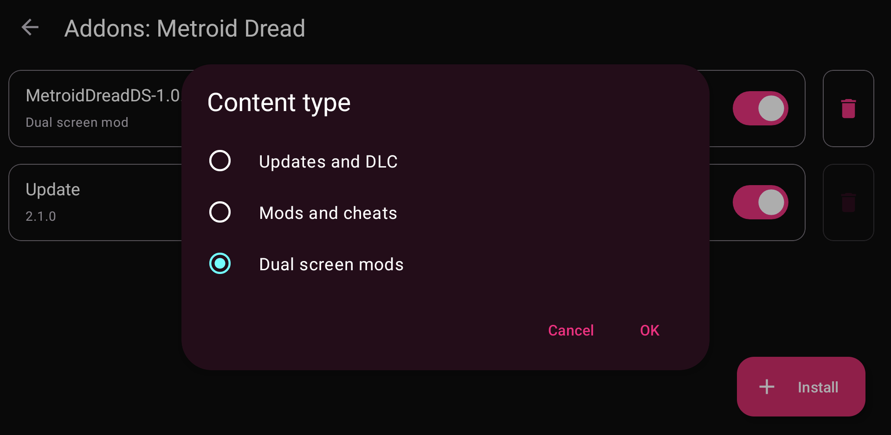

Installing a newer version of a companion replaces the older one.

---

## Persona 5 Royal

🥇 <a href="https://www.reddit.com/user/gymgooner123"></a>

<details>
<summary>Screenshots and details</summary>

`01005CA01580E000` · game version 1.0.2 · companion 1.1.0

| Field | Menu | Battle |
|:---:|:---:|:---:|
| 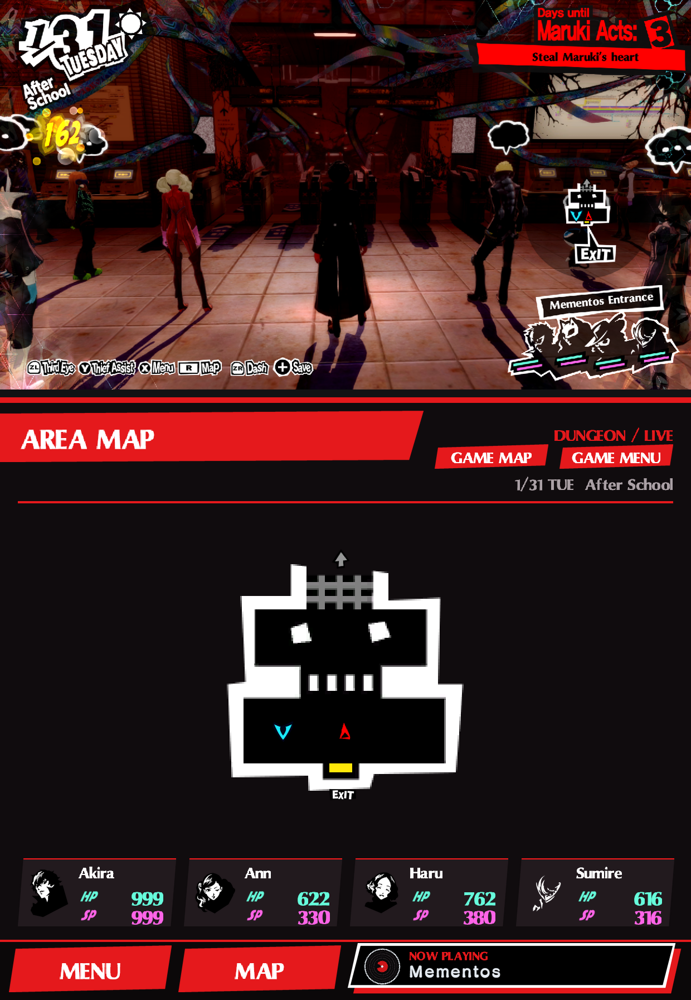 | 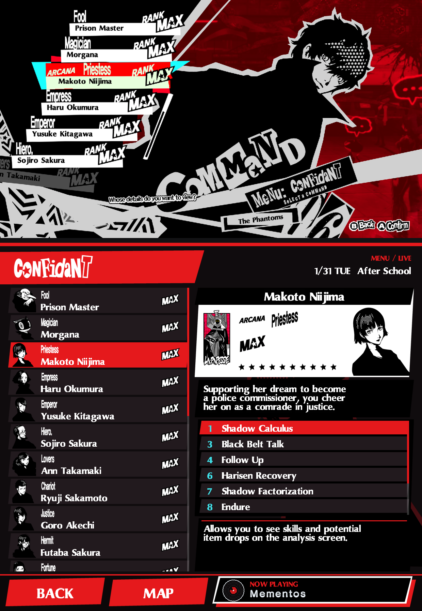 | 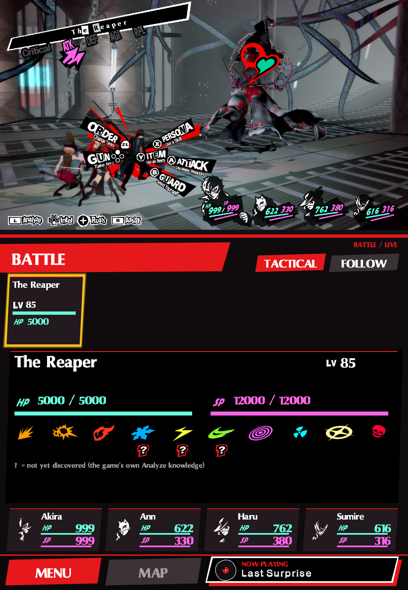 |

Follow your position on the area map, browse the native-style camp menu, and keep enemy and party information visible during battle.

A full bottom-screen version of the game's own start menu, with live data:

- **Skill, Item, Equip, Persona, Stats, Confidant, Request, Calendar.** Laid out like the native camp menu.
  - Confidants show the character, arcana, rank and rank abilities.
  - Stats include baton pass and down shot.
- **Use items, change equipment and change Persona from the touch screen.** Changes apply instantly by writing the same values the game's own menu writes. Items and skills the game would refuse are greyed out. Anything that is not reproduced exactly, or any request made while the camp menu is already open, is carried out by driving the native menu with button presses.
- **Calendar.** Browse months with L/R and tap any day for its plans. Past days show the game's Daily Log.
- **Battle.** Choose TACTICAL (enemy grid, selected enemy's details and affinities as in Analyze, party status) or FOLLOW, a lighter view that follows the action.
- **Field.** Area map with your position, date, time of day and money.
- **Dialogue.** Only choices are shown, as large buttons; tapping one selects it.
- **Now playing.** The current background music with its title.

The companion ships no game art: menus, fonts and icons are drawn from your own game files when the page first opens.

</details>

---

## Metroid Dread

<details>
<summary>Screenshots and details</summary>

`010093801237C000` · game version 2.1.0 · companion 1.0.0

| Map | EMMI zone | Water drain |
|:---:|:---:|:---:|
| 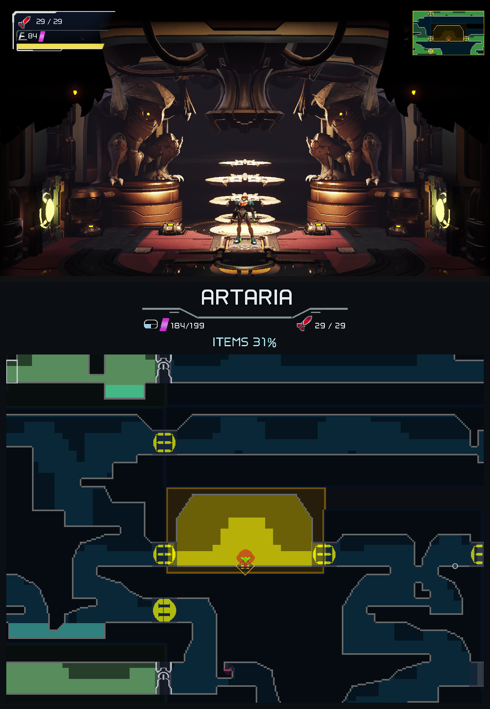 | 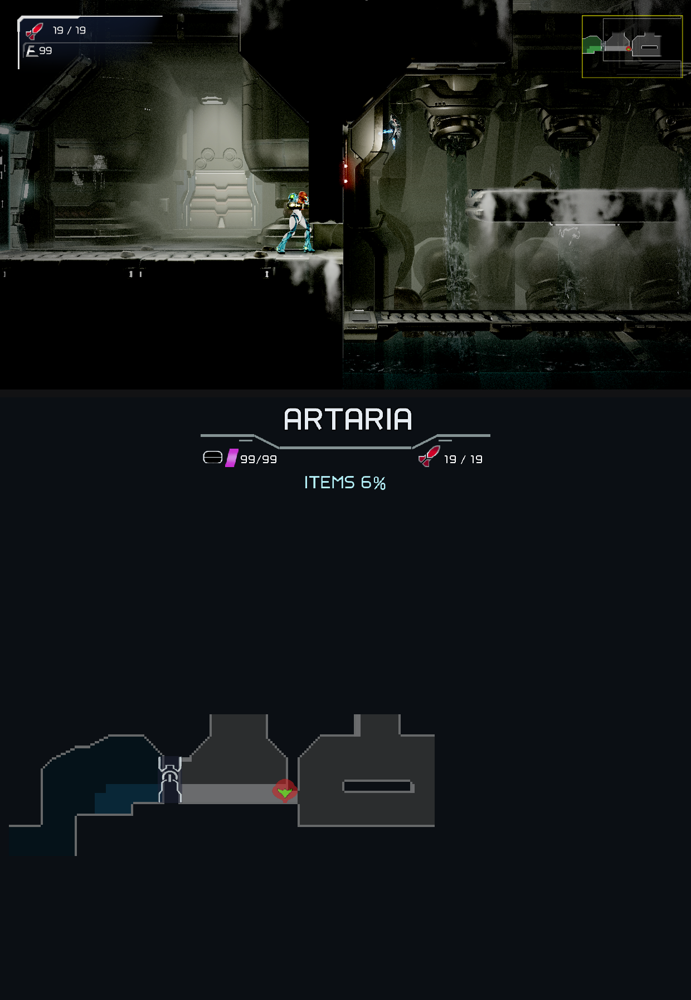 | 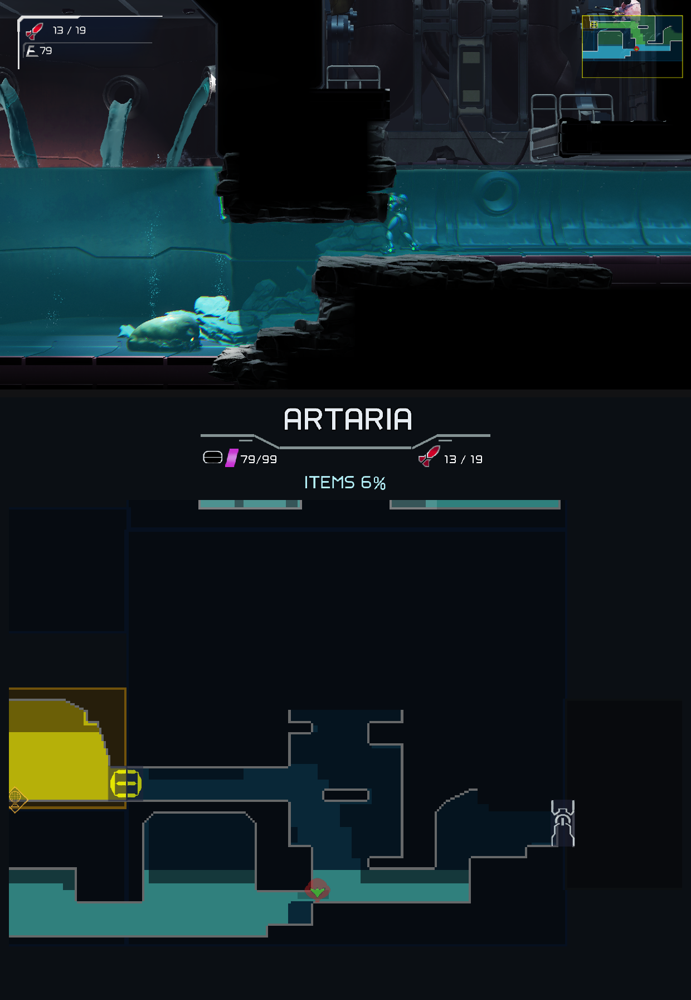 |

Keep explored rooms, doors and item markers beside the action. The EMMI and water-area examples show the map following different parts of Artaria.

A live area map on the second screen, drawn the way the game draws its own:

- **Area map** with Samus's position, rooms revealed as you explore, doors, items and your custom markers.
- **EMMI zones**: grey while the EMMI is active and green once it has been destroyed, read from the game's own state.
- **Water** as the game's map shows it, including the level moving while a pool drains or fills.
- **Status**: energy and tanks, missiles, power bombs and item collection percentage.

The companion ships no game art: map geometry and icons are built from your own game files.

</details>

---

## The Legend of Zelda: Link's Awakening

<details>
<summary>Screenshots and details</summary>

`01006BB00C6F0000` · game version 1.0.1 · companion 1.0.0

| Map | Gear | Items |
|:---:|:---:|:---:|
| 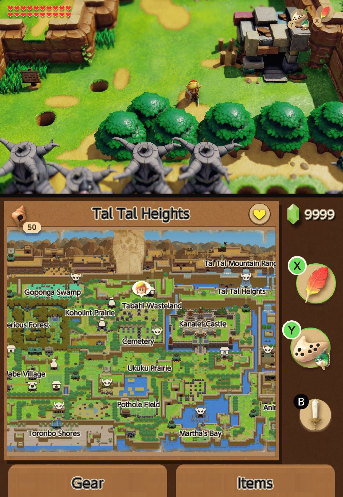 | 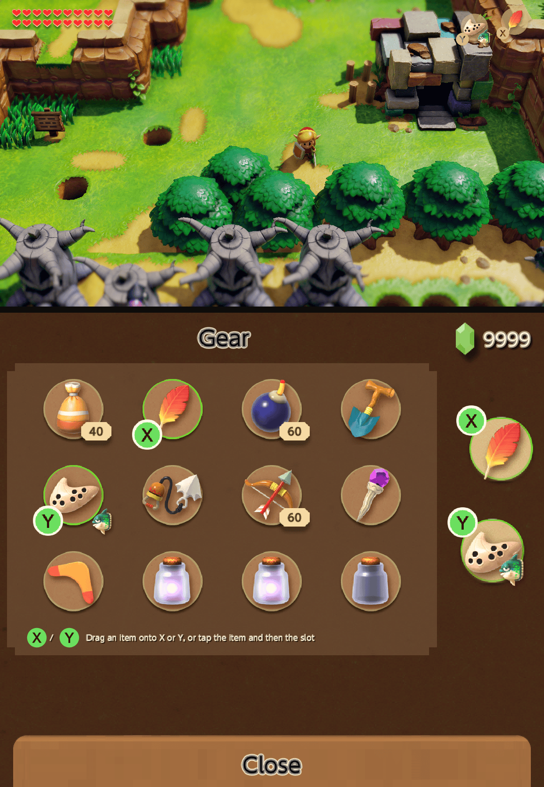 | 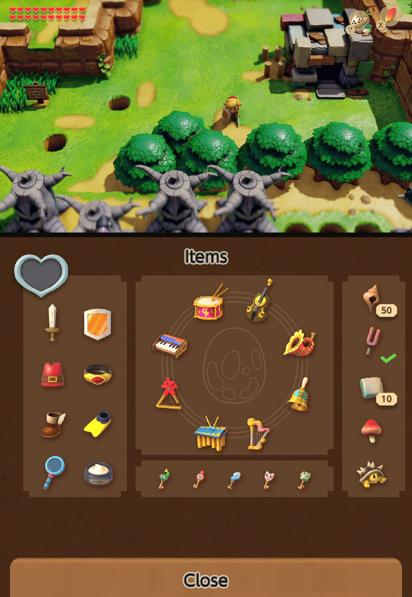 |

Browse the island map, equipment and collected items on the companion while the main screen stays on the adventure.

- **Map** of the overworld and dungeons with Link's live position, region names, rupees, seashells and what is on X, Y and B. Dungeon maps show rooms, chests, stairs and the boss room, and switch automatically when you enter a dungeon. Place, change and remove your own map pins.
- **Gear**: the items you can assign, such as magic powder, bombs, arrows, hookshot, rod, boomerang and bottles, with their counts. Equip to X or Y by dragging an item onto a slot, or by tapping the item and then the slot.
- **Items**: sword, shield, tunic, bracelet, boots, flippers and other equipment, the eight instruments, ocarina songs, trading item, heart pieces, secret seashells and secret stones.

The companion ships no game art: it uses your own game files.

</details>

---

## Mario Kart 8 Deluxe

<details>
<summary>Screenshots and details</summary>

`0100152000022000` · game version 4.0.1, 4.0.0 or 3.0.3 (CTGP-DX v1.1.1 on 3.0.3) · companion 1.0.1

Game version 4.0.1 support by [AntonyKor](https://github.com/AntonyKor).

| Map | Horn | Next race |
|:---:|:---:|:---:|
| 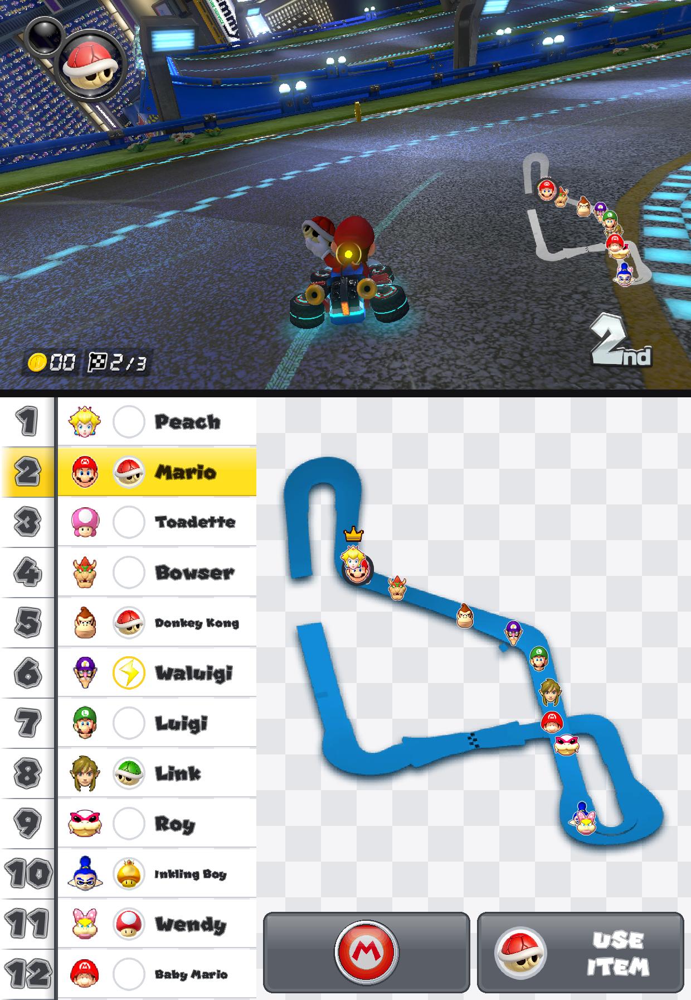 | 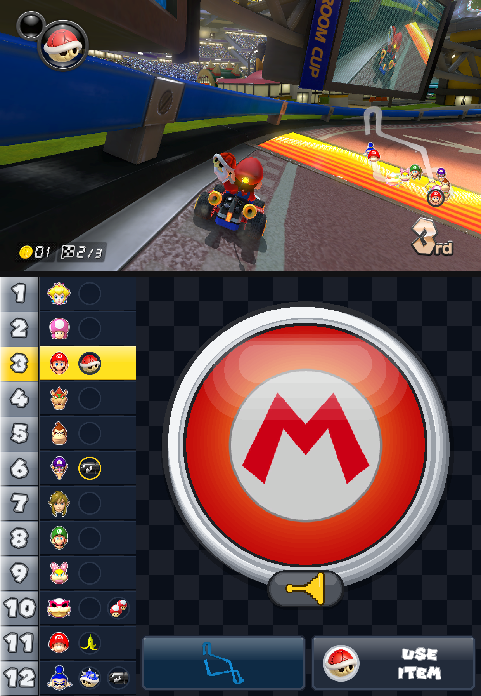 | 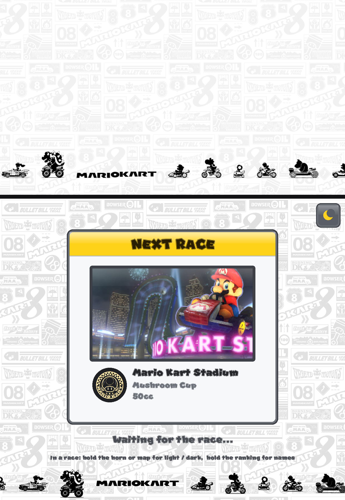 |

Follow standings and the course map during a race, use the touch horn, and see the next-race screen between events.

The race screen of the Wii U GamePad, on your second screen:

- **Rank bar.** A glass standings bar with all twelve racers in their live order and the items each one is holding right now. Your row is highlighted, finished racers get the checkered flag, and when racers overtake each other their cards slide into their new places.
- **Horn mode.** A big horn button with your kart's emblem. Tap it and your kart really honks.
- **Map mode.** The course map with every racer's live position, a crown on the leader and a ring around you. The companion starts in map mode.
- **Buttons.** **USE ITEM** fires your item. The other button switches between horn and map.
- **Two row formats and two themes.** Hold the rank bar to switch between short rows (icon and items) and long rows (with names). Hold the horn or the map to switch between the light and the dark theme. Both changes are animated, and taps and holds give haptic feedback.
- **Next race, loading and idle screens** on the game's own loading-screen art, with the course picture, cup and class.
- **CTGP-DX v1.1.1** on game version 3.0.3: custom tracks show their own maps, pictures and names. Install CTGP-DX in Eden Duo as a normal game mod (**Add-ons**, **Install**, **Mods**), next to the companion.
- **Other versions.** On an unsupported game version the companion shows which version it found and which ones it supports, and reads nothing.

The companion ships no game art: icons, maps, emblems, backgrounds, the font and all text are read from your own game files.

Limitations:

- One local player only. Local multiplayer (split screen) is not supported.
- Tested in Grand Prix races. VS races and Time Trials are untested.
- An item that is being used, such as an active Bullet Bill, is not shown in the rank bar.
- CTGP-DX is supported on game version 3.0.3 only, not on 4.0.0.

</details>

---

## Super Mario Bros. Wonder

⭐ <a href="https://www.patreon.com/cw/KalebPowell"></a>

<details>
<summary>Screenshots and details</summary>

`010015100B514000` · game version 1.2.1 · companion 1.0.2

| Title | World map | Course |
|:---:|:---:|:---:|
| 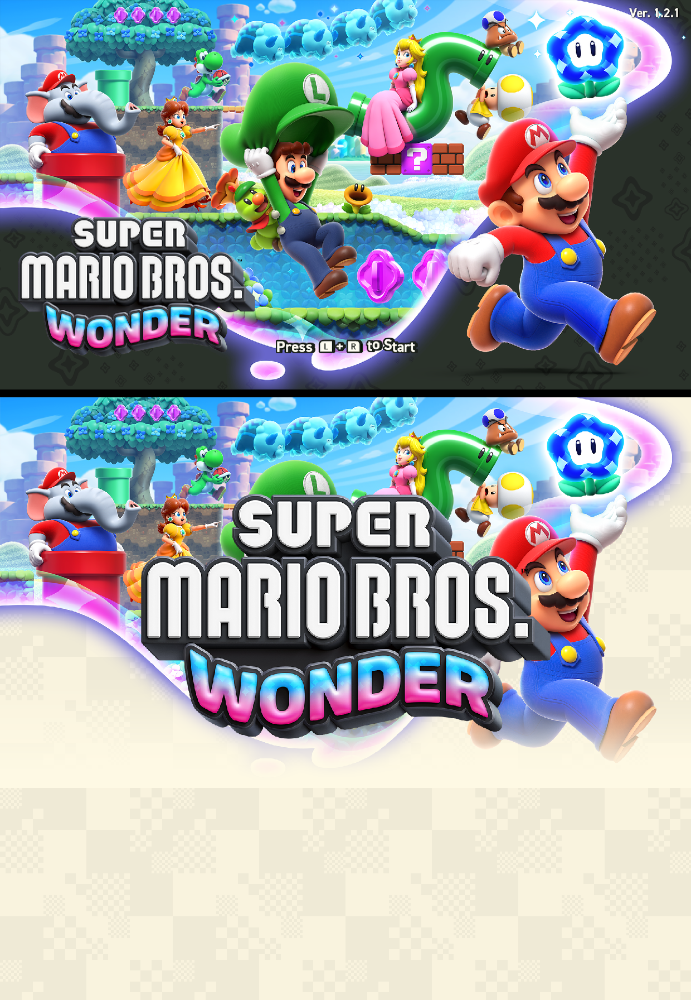 | 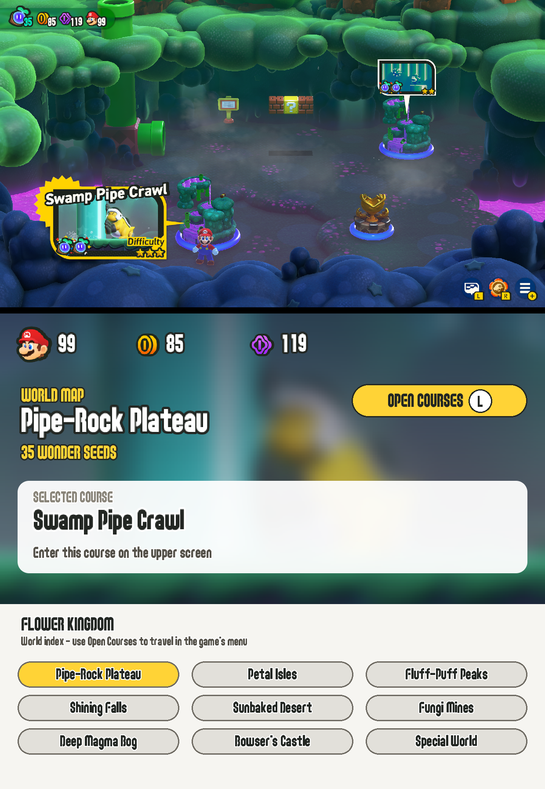 | 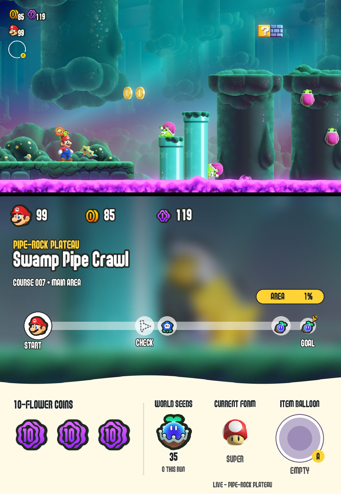 |

The title, world map and course views keep the game’s visual style across states. Course progress and collectible information sit alongside the platforming.

- **Course.** The world and course name over a blurred picture of the course, with a progress rail from start to goal that your character rides. In multi-area courses the rail follows verified links between areas, showing NEXT AREA at transitions and GOAL at real goal poles. It marks checkpoints, 10-flower coins, Wonder Seeds and the secret goal as found or missing, with Wonder Seed markers following the live collection flags, and shows how far through the area you are.
- **Status.** The course's 10-flower coins, the world's Wonder Seeds (and how many this run), your current form and the item in your balloon.
- **World map.** The world's name and seeds, the selected course, all nine worlds, and an **Open Courses** button that opens the game's course list.
- **Title screen** art while you choose your save and character.
- Lives, coins and flower coins in the game's own lettering.
- **Other versions.** On any other game version the companion shows a notice and reads nothing.

The companion ships no game art: pictures, icons, the font and course names are read from your own game files.

</details>

---

## Animal Crossing: New Horizons

🥇 <a href="https://ko-fi.com/W5J3253HW9"></a>

<details>
<summary>Screenshots and details</summary>

`01006F8002326000` · game version 3.0.3 · companion 1.0.0

| Island map | Pockets | Critterpedia |
|:---:|:---:|:---:|
| 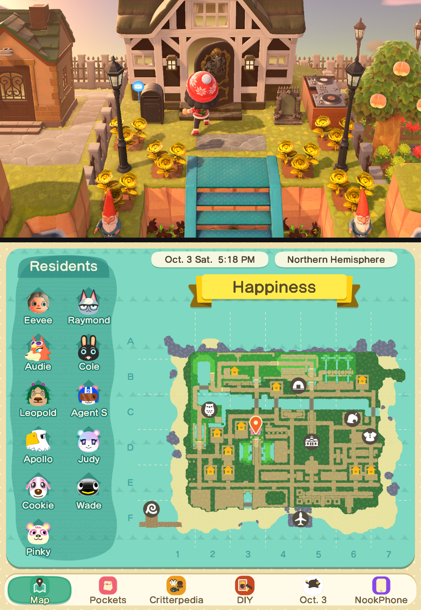 | 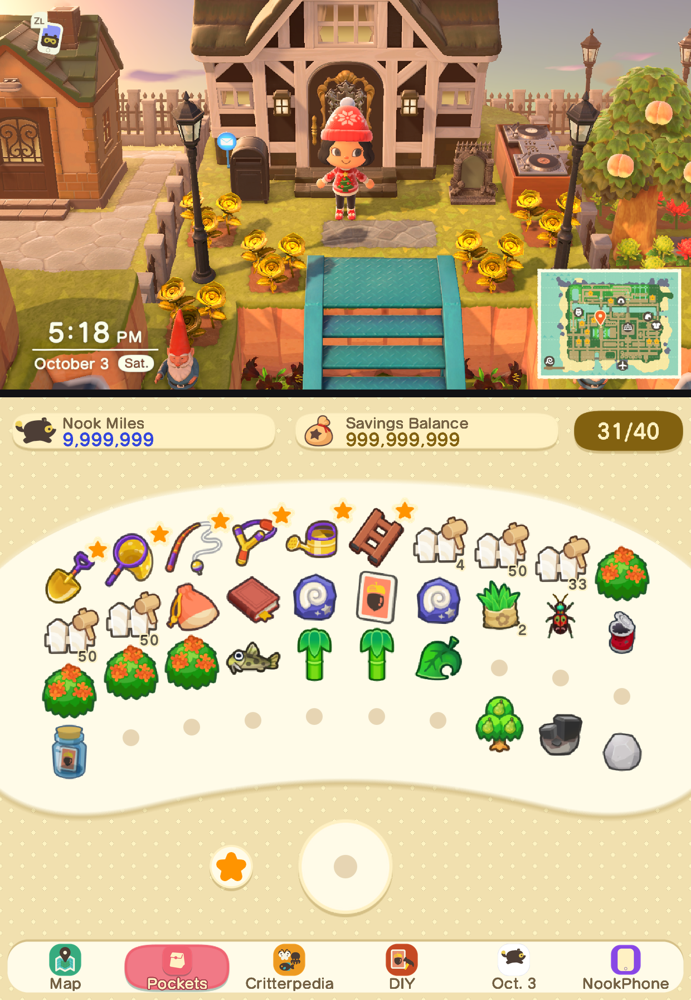 | 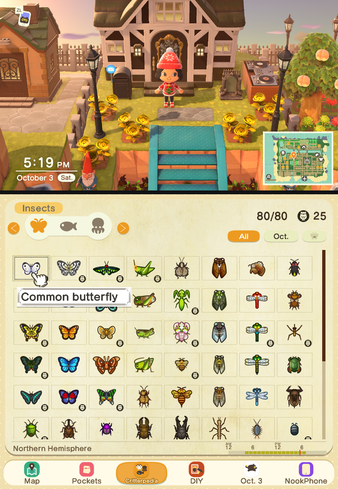 |

Keep the island map and residents visible, inspect pocket contents, and browse recorded creatures with the game’s own artwork.

Your island information and NookPhone pages, always within reach on the second screen:

- **Island map.** Follow your live position, find residents and facilities, and pan and zoom around your island.
- **Pockets.** Browse what you are carrying, with item names and quantities. Touch controls let you select items and equip tools.
- **Critterpedia.** Browse fish, bugs and sea creatures, with collection details and filters.
- **DIY.** Browse recipes by category, see their materials and mark favourites.
- **Today.** A separate page for the day's island information.
- **NookPhone.** Browse the phone's apps and open supported apps through the game's own controls.

The companion ships no game art: maps, item pictures, icons, fonts and text are read from your own game files.

</details>

---

## Fire Emblem: Three Houses

<details>
<summary>Screenshots and details</summary>

`010055D009F78000` · game version 1.2.0 · companion 1.0.0

| Monastery | Academy | Battle |
|:---:|:---:|:---:|
| 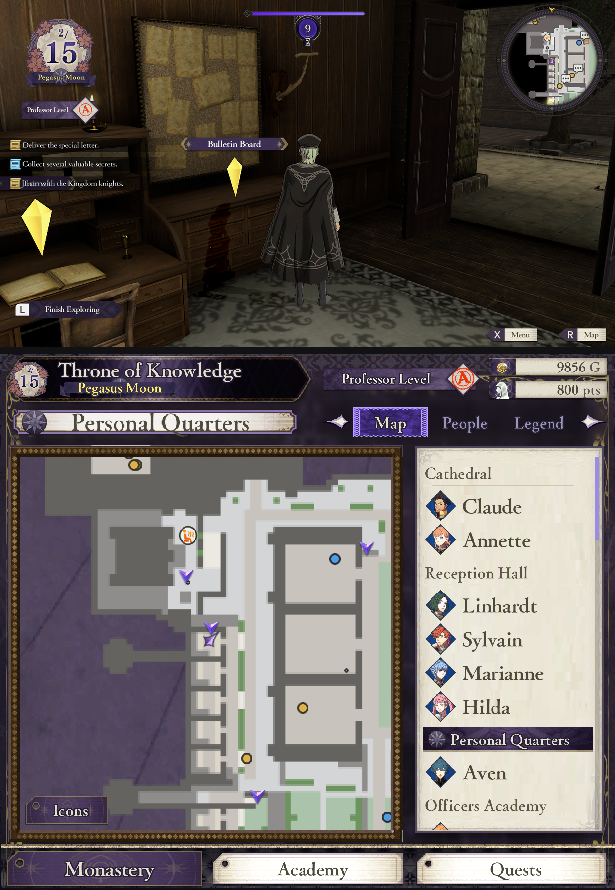 | 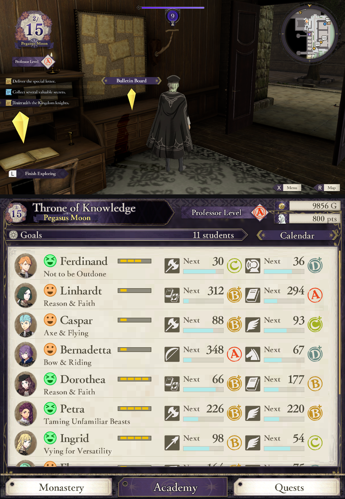 | 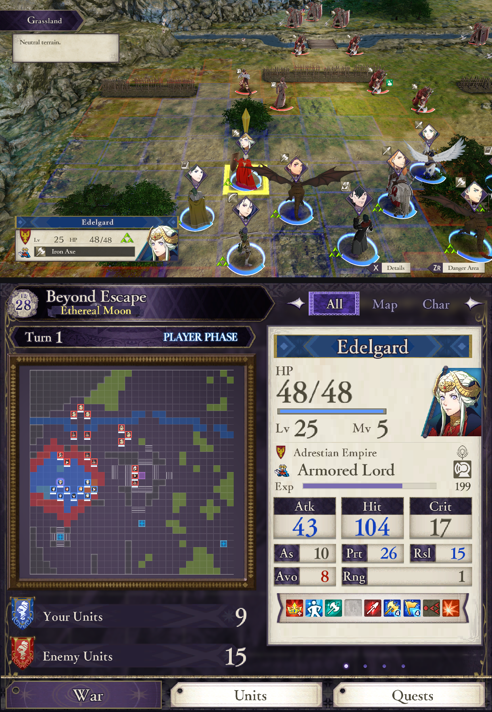 |

Switch between monastery navigation, academy information and battlefield details without crowding the main game screen.

Keep the monastery, your students and the battlefield on the second screen:

- **Monastery.** A live map with your position, people and facilities. Pan and zoom, switch between the map, people and legend, and toggle the icons.
- **War.** A tactical map and selected unit details, with combined, map and character layouts.
- **Academy.** Browse the roster and inspect a character's status, items, combat arts, abilities, battalion and skill levels.
- **Calendar.** Open the calendar from the Academy page and select a day.
- **Quests and lost items.** Browse the quest log by status, inspect objectives and rewards, and see the lost items you are carrying.

The companion ships no game art: maps, portraits, icons, fonts and text are read from your own game files.

</details>

---

## The Binding of Isaac: Afterbirth+ and Repentance DLC

🥇 <a href="https://ko-fi.com/U3I527XBIL"></a>

<details>
<summary>Screenshots and details</summary>

`010021C000B6A000` · game version 1.7.9b (Switch update v524288) · companion 1.0.2

| Map | Items | Room |
|:---:|:---:|:---:|
| 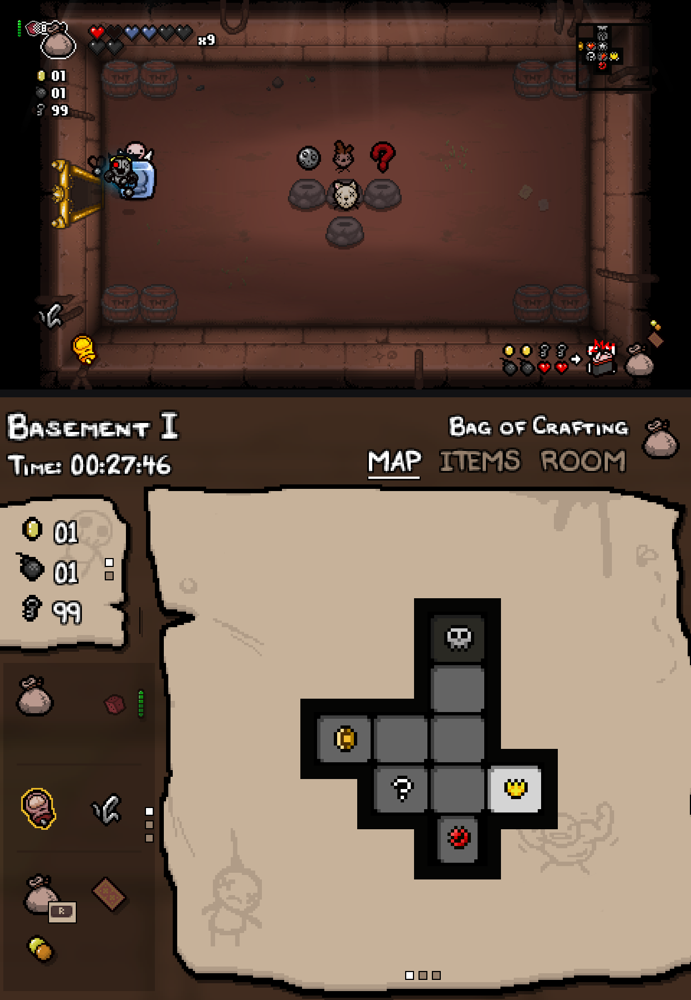 | 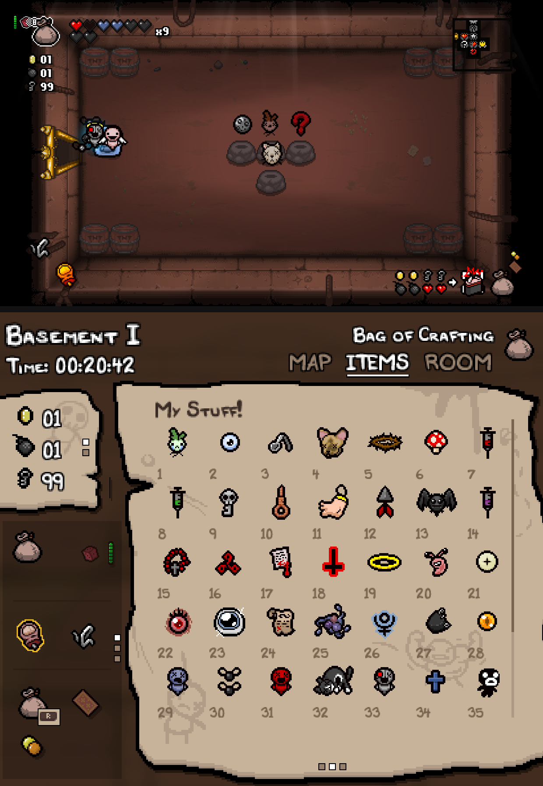 | 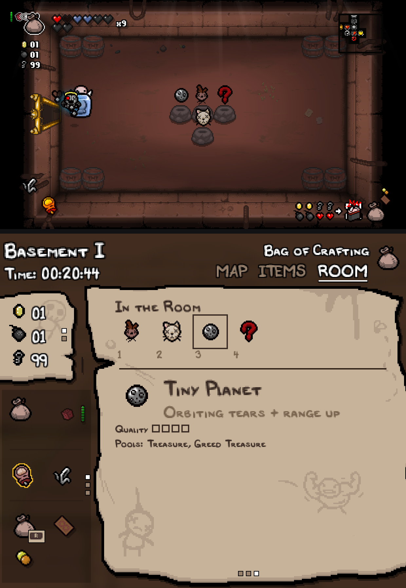 |

Keep the floor layout visible, inspect collected items, and read the selected room pickup’s description while the main screen shows the room.

A parchment companion for your run, with one package for **Afterbirth+ without DLC** and **Repentance with its DLC installed and enabled**. It selects the edition automatically.

- **MAP.** Follow the live floor map and your current room.
- **ITEMS.** Browse the items collected during the run and tap one to inspect it.
- **ROOM.** See collectible pedestals and ground trinkets in the current room and inspect what is on offer.
- **Counters and stats.** Keep track of your run alongside the main sheet. The lower card cycles between held items, a bag when available, and stats.
- **External Item Descriptions (EID).** Optional descriptions use the selected edition's item data. The switch starts off and remembers your choice. Descriptions are from [External Item Descriptions](https://github.com/wofsauge/External-Item-Descriptions) by wofsauge and contributors.
- **Touch and swipe.** Switch pages, select items and swipe between the side panels, with short transitions and haptic feedback. The controller stays with the game, so the L+R+L3+R3 quick reset works.

The companion ships no game art: parchment, icons, item pictures and fonts are read from your own game files. EID description data is included separately.

The launcher must be updated to 1.7.9b in either edition; unpatched base v0 is not supported.

</details>

---

<a id="pokemon-brilliant-diamond-luminescent-platinum"></a>

## Pokémon Brilliant Diamond / Luminescent Platinum

🗳️ <a href="https://ko-fi.com/polls/Next-Switch-Game-on-Eden-Duo-M0V127VUYA"></a>

`0100000011D90000` (Brilliant Diamond) · game version 1.3.0 (vanilla or Luminescent Platinum 2.2F) · companion 1.0.0

| Map | Party | Battle |
|:---:|:---:|:---:|
| 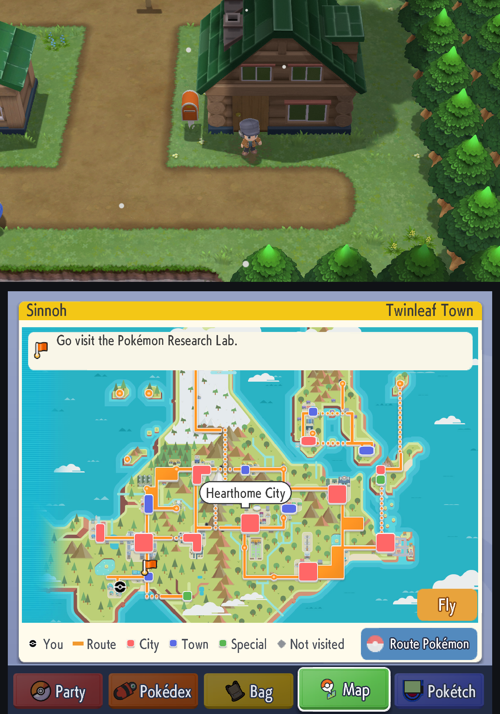 | 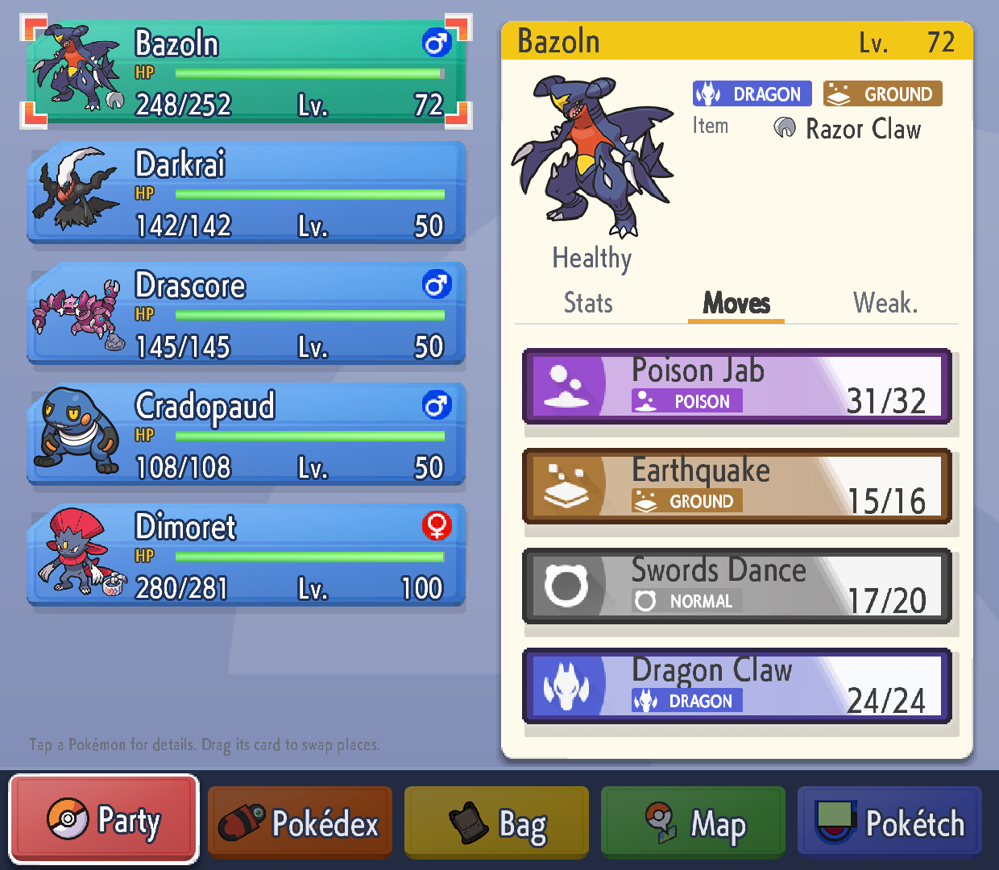 | 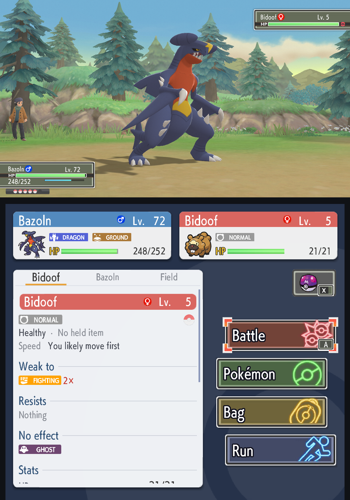 |

The Sinnoh map keeps your position and destination visible; Party exposes move order and PP; Battle presents native commands and opponent information.

Requires Eden Duo 1.2.1 or newer.

Keep the map, party and battle controls on the second screen.

- **Map.** Follow the field map, pan and zoom, and keep the saved outdoor position visible while indoors.
- **Party.** Inspect Pokémon and moves, drag to reorder party members and move slots, and use supported medicine actions.
- **Bag and Pokédex.** Browse native items and recorded Pokémon, with pocket and sort controls.
- **Pokétch.** Use supported apps with their game artwork and LCD controls.
- **Battle.** Native command and move controls, party status and supported target selection.

The companion ships no game art: pictures, fonts and text are read from your own game files.

Limitations:

- Supports Brilliant Diamond 1.3.0, vanilla or with Luminescent Platinum 2.2F.
- Shining Pearl has its own package; do not install the Brilliant Diamond package for Pearl.

---

<a id="pokemon-shining-pearl-luminescent-platinum"></a>

## Pokémon Shining Pearl / Luminescent Platinum

🗳️ <a href="https://ko-fi.com/polls/Next-Switch-Game-on-Eden-Duo-M0V127VUYA"></a>

`010018E011D92000` · game version 1.3.0 (vanilla or Luminescent Platinum 2.2F) · companion 1.0.0

| Map | Party | Pokétch |
|:---:|:---:|:---:|
| 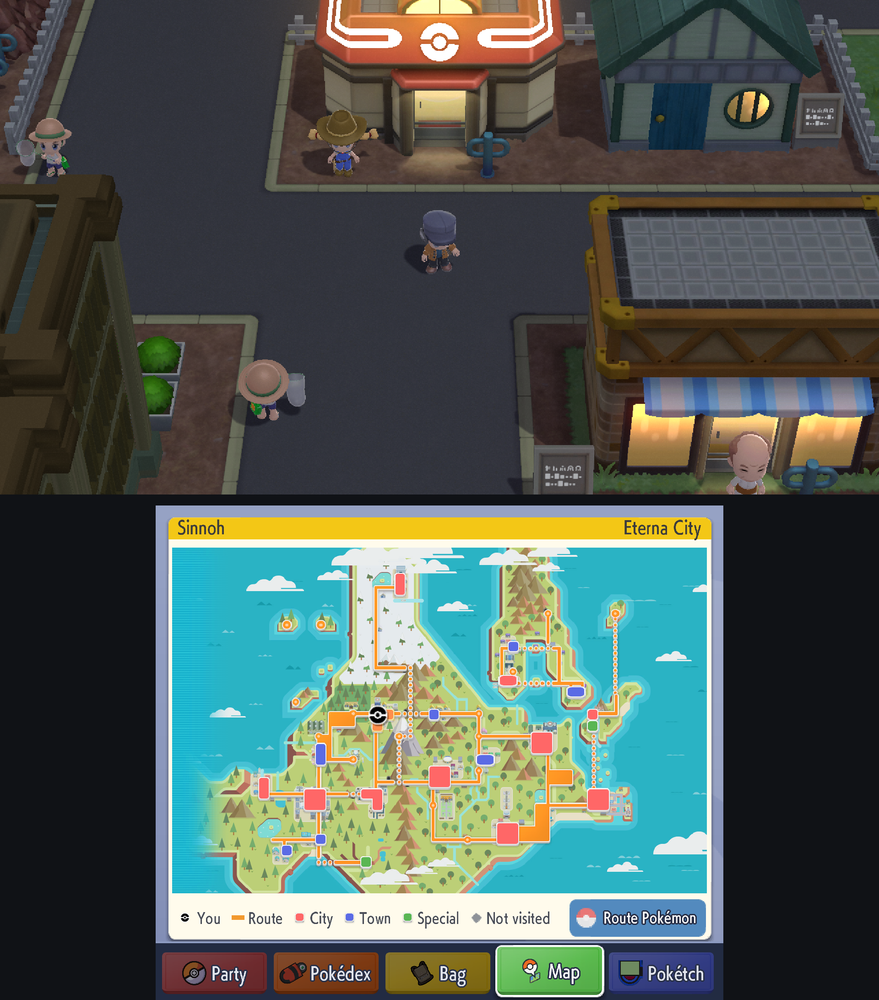 | 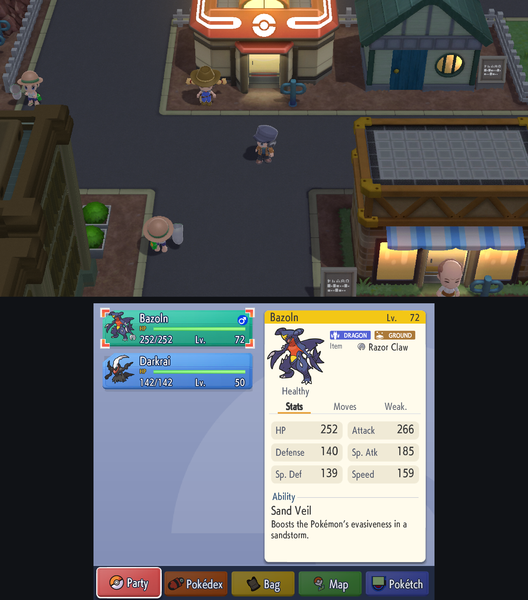 | 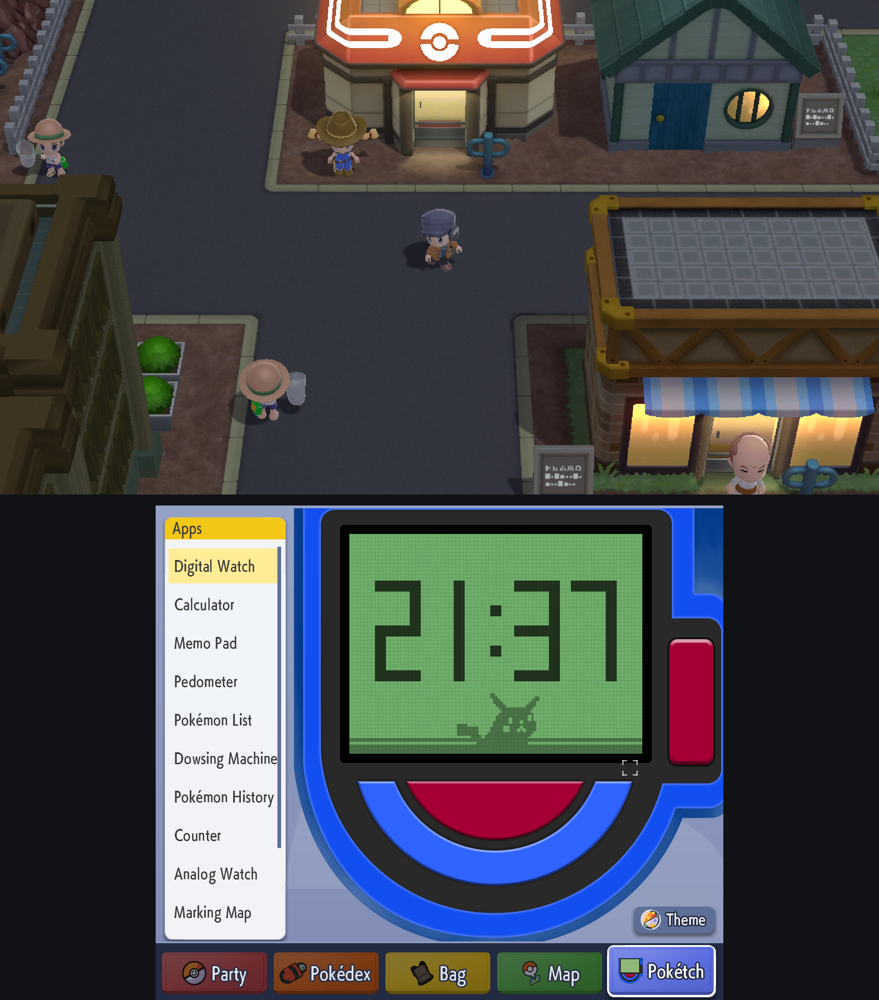 |

The Shining Pearl companion shows the Sinnoh map, party details and its own Pokétch, here with Luminescent Platinum.

Requires Eden Duo 1.2.1 or newer.

It has the same Map, Party, Bag, Pokédex, Pokétch and Battle pages as the Brilliant Diamond companion. Install this package for Shining Pearl, vanilla or with Luminescent Platinum 2.2F.

The companion ships no game art: pictures, fonts and text are read from your own game files.

---

## Crash Team Racing Nitro-Fueled

<details>
<summary>Screenshots and details</summary>

`0100F9F00C696000` · game version 1.0.15 · companion 1.0.0

| Race | HUD settings | Native HUD comparison |
|:---:|:---:|:---:|
| 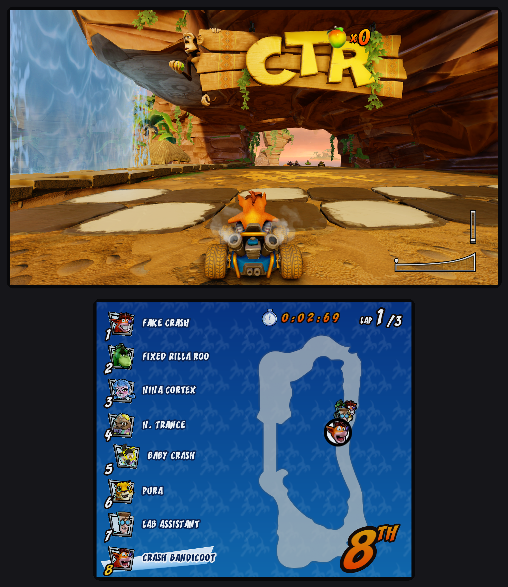 | 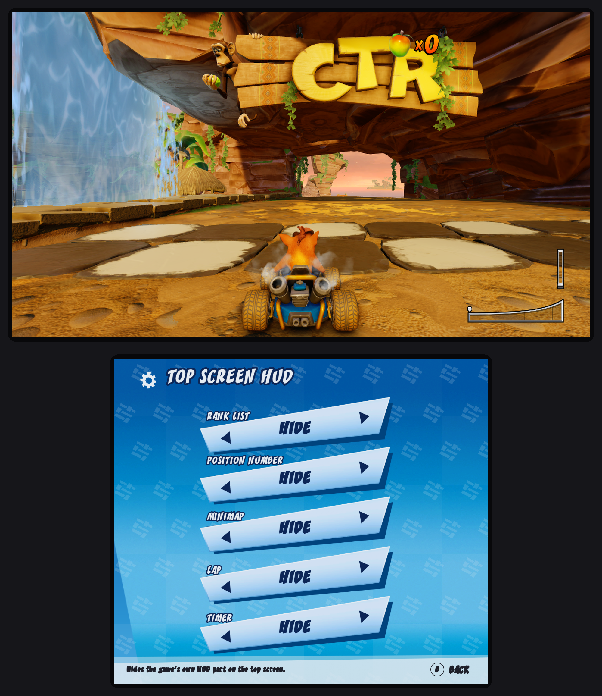 | 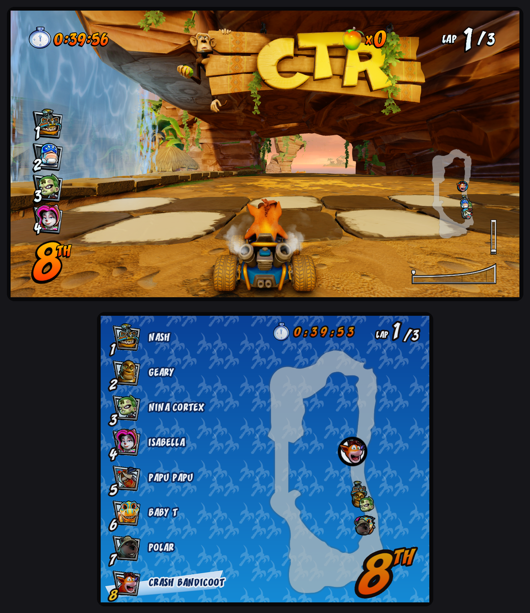 |

Follow racer order, course positions, lap and clock on the companion. The settings and comparison views show control of the native game’s five HUD elements.

A live race panel with the game’s own art and racer names.

- **Standings.** Follow racer order, names and portraits, with animated rank changes.
- **Course map.** Live racer positions on the native minimap.
- **Race status.** Your position, lap and race clock.
- **HUD settings.** Show or hide the native rank list, position, minimap, lap and timer.
- **Other versions.** Known older builds show a version notice and do not use the supported reader.

The companion ships no game art: pictures, fonts and text are read from your own game files.

Limitations:

- Designed for one local player in races.

</details>

---

## Dragon Quest III HD-2D Remake

🥇 <a href="https://ko-fi.com/G0I027XSOG"></a>

<details>
<summary>Screenshots and details</summary>

`01003E601E324000` · game version 1.1.0.0 · companion 1.0.0

| Map | Party | Battle |
|:---:|:---:|:---:|
| 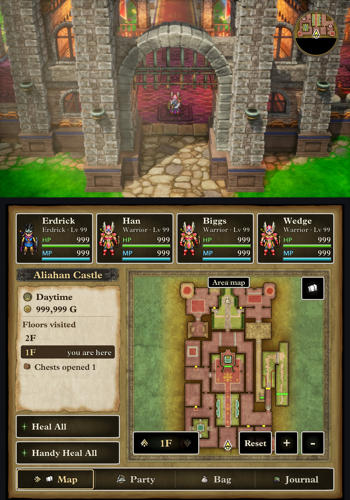 | 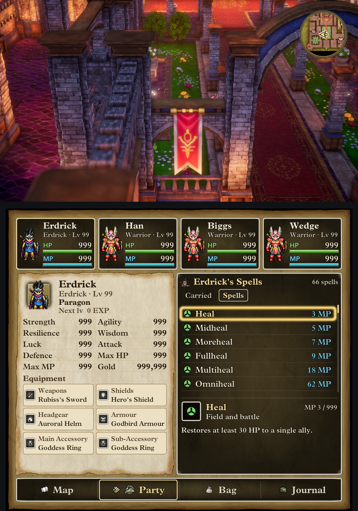 | 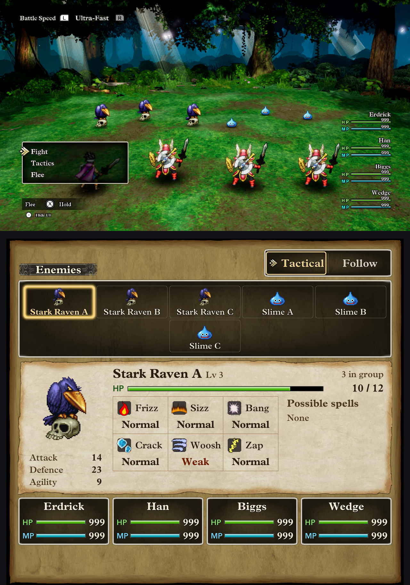 |

Keep the current map and floor information beside exploration, inspect party spells and equipment, and view enemy details and possible spells during battle.

Keep the world, party and battle information beside the main game.

- **Map.** Live field map, three map scales and a fullscreen view.
- **Party.** Status, equipped gear, carried items and spells.
- **Bag and Journal.** Browse shared items and the game’s journal information.
- **Healing.** Heal All and Handy Heal All straight from the companion, without opening the in-game menu.
- **Battle.** Tactical and Follow pages for the current encounter, including possible enemy spells.

The companion ships no game art: pictures, fonts and text are read from your own game files.

Limitations:

- Supports executable build 4F41309B39EEBE5E; other builds are not validated.

</details>

---

## Chained Echoes

🥇 <a href="https://ko-fi.com/U7U31RLL6S"></a>

<details>
<summary>Screenshots and details</summary>

`0100C510166F0000` · game version 1.41 · companion 1.0.0

| Field | Battle | Crystals planner |
|:---:|:---:|:---:|
| 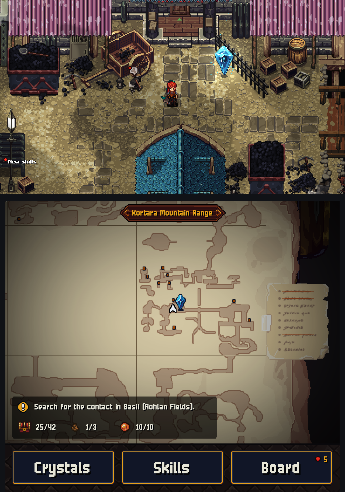 | 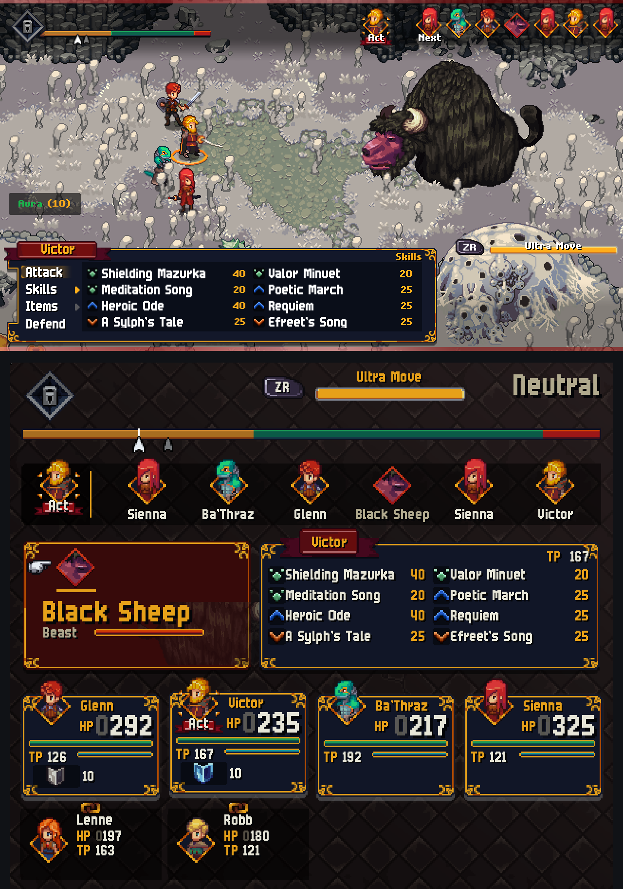 | 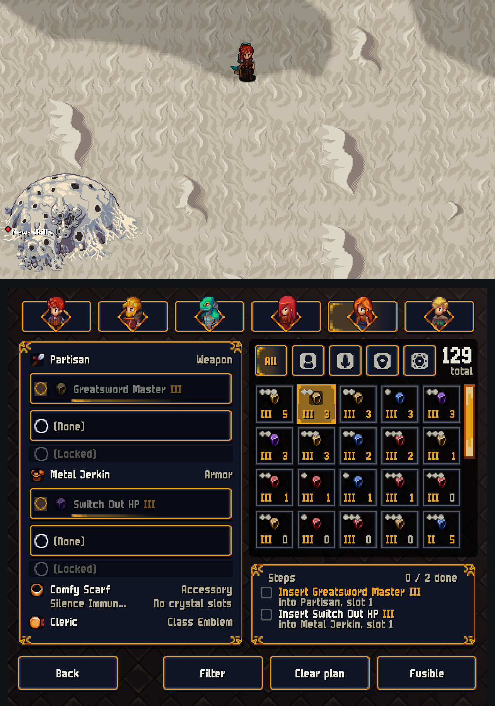 |

Field Home combines the native area map with exploration information. Battle keeps skills, turn order and Overdrive together; Crystals lets you plan slot changes before making them in the native menu.

Follow exploration and combat, and plan skills and crystals on the second screen.

- **Field Home.** The native area map, current objective, area collectibles and Reward Board.
- **Battle.** Live turn strip, Overdrive and selected actor information, including Sky Armor encounters.
- **Skills.** Browse skills and plan slot changes, then follow the native menu’s equipped state.
- **Crystals.** Browse and filter crystals, plan slots and transfers, and mirror supported smith screens.
- **Formation.** Follow active members and linked reserves on the native Formation screen.
- **Motion and touch feedback.** Page changes, strip movement and supported picture transitions; haptics follow the system touch-feedback setting.

The companion ships no game art: pictures, fonts and text are read from your own game files.

Limitations:

- Supports update build 17B6A110CC529FBE; the base build only shows an unsupported-version notice.
- Skill and crystal plans guide changes in the native menu; the companion does not independently apply smith fusion or equipment edits.

</details>

---

## Yoru Tomosu

<details>
<summary>Screenshots and details</summary>

🥇 <a href="https://ko-fi.com/igawa6/commissions"></a>

`0100C2901153C000` · game version 1.0.0 · companion 1.0.0

| Log | Option | CG |
|:---:|:---:|:---:|
|  |  |  |

Browse past dialogue and unlocked art on the second screen while the story stays on the main one.

- **Log.** The game's own retained dialogue history, newest past line first, with the current line left off the list. Drag or fling to scroll, drag the scrollbar, jump with Latest and Oldest, and set the text size from the header.
- **Option.** Scroll speed, follow-newest, and the installed English patch's two controller diagrams.
- **CG.** A scrolling grid of unlocked art; tap a thumbnail to view it full screen, then tap again to return to the grid.
- Start and waiting screens, and haptic feedback on the second screen.
- Read-only: the companion sends no inputs, calls or memory writes to the game.

The companion ships no game art: dialogue, fonts and pictures are read from your own game files and patch.

</details>

---

## Diablo III: Eternal Collection

<details>
<summary>Screenshots and details</summary>

🥇 <a href="https://ko-fi.com/Z2B723BQK6"></a>

`01001B300B9BE000` · game version 2.7.7 or 2.7.6 · companion 1.0.0

| Map | Hero | Gear |
|:---:|:---:|:---:|
|  |  |  |

Keep the map, hero sheet and gear beside the action, read live from the running game.

- **Map.** A hero-centred, smooth-panning map with the game's own markers: waypoints, exits, shrines, chests, and bounty and rift objectives. A skill rail sits alongside it, and nearby elites and champions show their name and affixes on tap.
- **Hero.** Name, class, level and paragon, health and primary resource, gold, blood shards and other currencies, active buffs, core stats, Kanai's Cube powers, and the current difficulty and area.
- **Activities.** Act bounties and their state, and Nephalem/Greater Rift progress with the Rift Guardian.
- **Gear.** The 13-slot paperdoll and backpack grid with item tooltips. Equip and Unequip apply instantly; Drop drives the native inventory menu.
- **Options.** Turn skill-rail tap-to-use on or off.

The companion ships no game art: portraits, item icons and map art are read from your own game files.

</details>

---

## Farming Simulator: Nintendo Switch Edition

<details>
<summary>Screenshots and details</summary>

🥇 <a href="https://ko-fi.com/igawa6/commissions"></a>

`0100D04004176000` · game version 1.5.0.1 · companion 1.0.1

| Map | Garage | Prices |
|:---:|:---:|:---:|
|  |  |  |

Run the farm's menus on the second screen while the field stays on the main one.

- **Map.** A pan/zoom field map that keeps your own position marked even while you pan or zoom, with the game's own icons for vehicles, harvesters, trailers, tools, selling points and field jobs. A Filters popup picks which of the 7 marker categories show (hidden markers can't be tapped), Expand fills the screen, and Reset glides back to following you. Crops, growth and soil layers overlay the map on the supported build.
- **Garage.** Your owned vehicles with their specs; Enter and Reset apply instantly, with no menu to drive through.
- **Operations, Prices, Finances, Statistics, Animals, Shop and Guide.** The rest of the game's menus, including a five-day price history and finances, session and total statistics, and a static English guide, all on native two-axis scrolling panes.

The companion ships no game art: icons, maps and text are read from your own game files.

</details>

---

## VA-11 Hall-A: Cyberpunk Bartender Action

<details>
<summary>Screenshots and details</summary>

⭐ <a href="https://ko-fi.com/matinc"></a>

`010086500D3C8000` · game version 1.0.0 · companion 1.0.0 (VAllhalla, by Mati)

Mix drinks on the second screen while the story plays on the main one.

- **Bar.** Drag cans into the shaker, toggle Ice and Age, then shake the shaker with your finger, tap Mix or press ZR. The blend bar fills as you shake, then SUCCESS or the error windows appear; Serve or Reset. The shaker contents, Ice, Aging, mixing, the night's money and the customers are read from the game, so the panel stays in sync whichever screen you pour with.
- **Stand-by.** Away from the bar, Jill waits at the counter during dialogue with her face following the scene, the game's break doodles show on breaks, and the title screen shows its Jill. Tap Jill's scene to advance the dialogue; hold the stand-by screen to open the bar anyway.
- **Game sounds.** The ice in the shaker and the error-window click are the game's own sounds, played by the game.
- **Inputs.** The companion presses ZR, ZL and A for you (mix, reset, next line) and asks the game to play its sounds; it never writes game memory directly.

The companion ships no game art: Jill, the cans, the shaker, the drinks, the doodles, the sounds and the dialogue are read from your own game files. The bar window, the SUCCESS and error windows and the other overlay art are original to the companion.

</details>

---

## The Legend of Zelda: Breath of the Wild

🗳️ <a href="https://ko-fi.com/polls/2nd-Poll-Next-Switch-Game-on-Eden-Duo-Q6B3284653"></a>

`01007EF00011E000` · game version 1.6.0 · works with or without DLC · companion 1.0.0

| Ready | Inventory | Map |
|:---:|:---:|:---:|
|  |  |  |

The Sheikah Slate moves to the second screen: equip, eat, plan and travel without opening the pause menu.

- **Ready.** A round map that follows you, with your location, time, temperature and weather, rupees and the active quest. It shows your equipped weapon, bow, shield and arrows with durability, and your runes. Swap gear or runes from touch grids, or hold a controller button to pick them. Cards appear when you need them: the nearest shrine when the Sheikah Sensor is on, and food when your hearts run low.
- **Inventory.** Every category in the game's own order and sort, with full item details. Tap to equip, remove or eat. Swipe to switch weapons. Hold materials or food to cook. If your weapon breaks, your previous secondary weapon is equipped again.
- **Map.** A pan-and-zoom map of Hyrule with the game's own icons and place names. Place, move and remove pins and stamps, which are saved to your game. Layers choose what shows. Travel to any shrine or tower you have activated.
- **Quests, Trackers and Recipes.** Choose the active quest, track the materials you still need and show where to find them, and browse meals and elixirs you can cook with what you own.
- **Title, loading and pause** each have their own view. While the pause menu is open on the main screen, the second screen dims instead of competing with it.
- **DLC.** Works with or without the DLC. With it, DLC items such as the Travel Medallion appear and work as well.
- **Other versions.** On any other game version the companion shows a notice and reads nothing.

The companion ships no game art: icons, the map, the font and all text are read from your own game files.

Requires Eden Duo 1.3.2 or newer.

---

## Castlevania: Belmont's Curse

🥇 <a href="https://www.reddit.com/user/gymgooner123"></a>

`0100BA4026E94000` · game version 1.1.0 · companion 1.0.0

| Map | Equipment | Pins |
|:---:|:---:|:---:|
|  |  |  |

Keep the map, your pins and your loadout on the second screen while Belmont explores the castle on the main one.

- **Map.** The game's own Map tab, always open: the current area and sub-area, explored-zone fog, discovered landmark engravings and name ribbons, and the active main objective. An Area/Sub-area rail and Reset drive the local pan/zoom view.
- **Pin.** Choose one of the game's nine native marker symbols and tap the map to place it, or tap an existing pin to change or remove it. Pins are placed directly in the game and saved exactly like the game's own map markers.
- **Equipment.** Arcana, weapon and relics with their art and names, and final ATK/DEF/HP/MP, read the way the game's own menu shows them. Tap an item to equip it instantly.
- **Feel.** Short fades between pages and haptic feedback on taps, equips and pin changes.

The companion ships no game art: map geometry, fog, landmarks, fonts, icons and equipment artwork are read from your own game files.

---

<a id="super-mario-odyssey"></a>

## Super Mario Odyssey

🥈 <a href="https://ko-fi.com/s/9e92af191b"></a>

`0100000000010000` · game version 1.4.1 · companion 1.0.0

| Map | Stats | Warp Here |
|:---:|:---:|:---:|
| 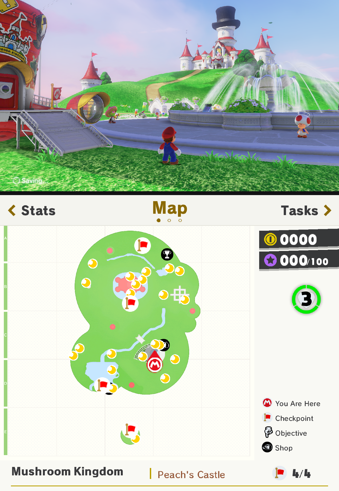 | 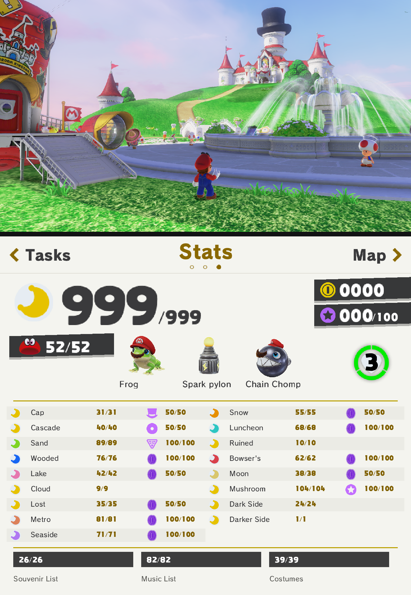 | 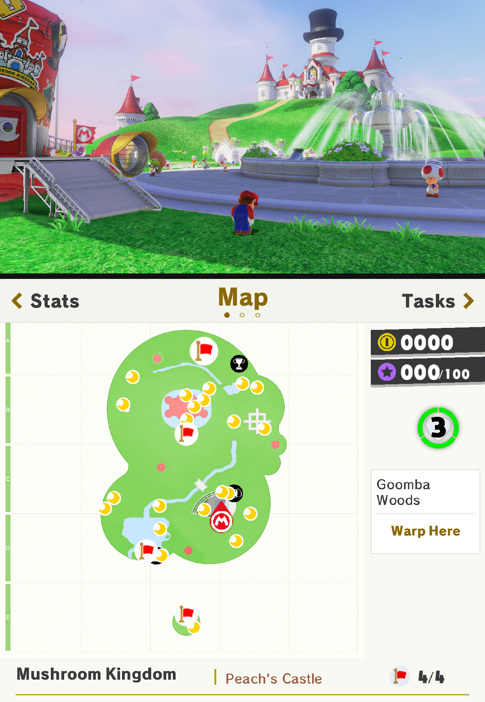 |

Mario's Travel Brochure moves to the second screen: track Moons, check in with Toadette and warp across Kingdoms without opening the pause menu.

- **Map.** Your live position and facing, camera direction and the current objective, on the map of the Kingdom you're in. Checkpoint flags you've touched get a one-tap Warp Here, using the game's own travel. Shops, minigames and Talkatoo are marked, along with every Power Moon you've collected; an optional "Show Uncollected Moons" setting reveals the rest.
- **Tasks.** All 61 Toadette achievements, with progress on each and a running count of how many are ready to claim.
- **Stats.** Global and per-Kingdom Moon counts, regional coin totals, your capture list with portraits, and your souvenir, music and costume counts.
- **Globe and Collection Lists.** While the in-game globe (Kingdom select) is open, the selected Kingdom's headline and what's left to find in the Kingdoms you've visited; while a Collection List is open, its own matching page.
- **HUD.** An optional "Hide Top-Screen HUD" setting moves the native overlay off the main screen; it returns the moment the companion itself is hidden.
- Press and hold the companion to open settings.
- Kingdoms you haven't visited yet, and post-game content, stay hidden until you reach them.

The companion ships no game art: text, icons and Kingdom data are read from your own game files.

Limitations:

- The shop overview page is not included yet.

Requires Eden Duo 1.3.2.2 or newer.

---

<a id="the-legend-of-zelda-echoes-of-wisdom"></a>

## The Legend of Zelda: Echoes of Wisdom

🗳️ <a href="https://ko-fi.com/polls/3rd-Poll-Next-Switch-Game-on-Eden-Duo-C7J128KB48"></a>

`01008CF01BAAC000` · game version 1.1.0 · companion 1.0.0

| Map | Notebooks | Equipment |
|:---:|:---:|:---:|
| 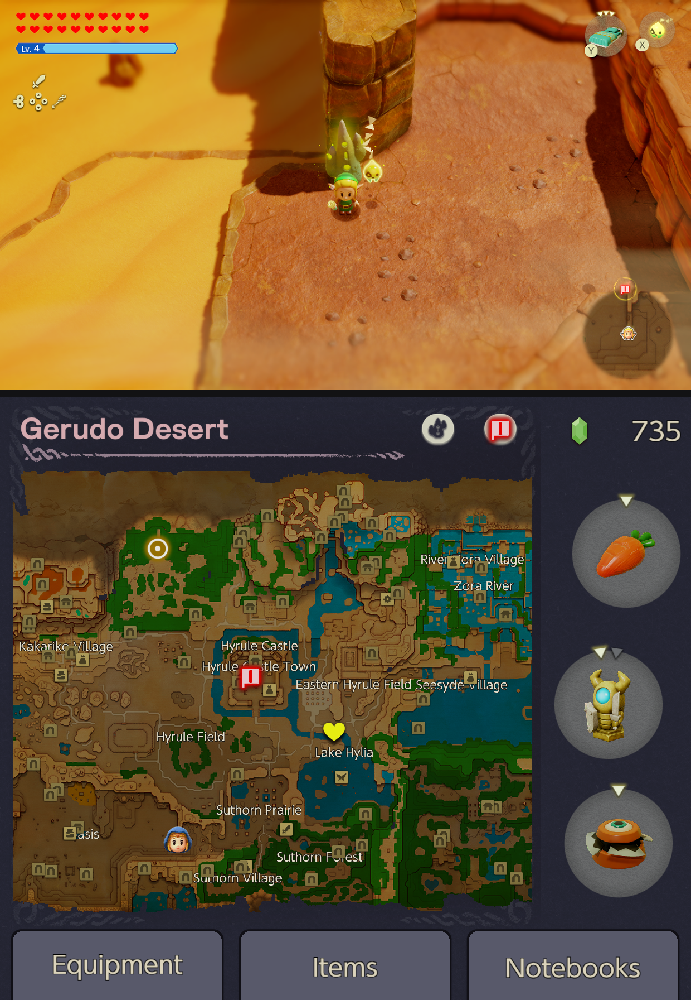 | 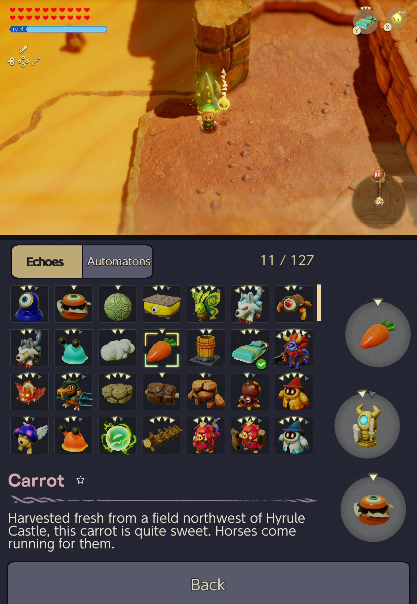 | 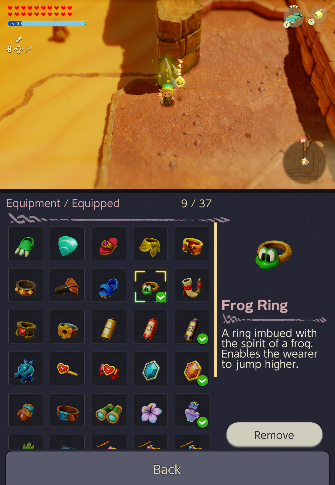 |

Zelda's map, Echoes and gear on the second screen, so you can swap, eat and plan without opening the pause menu.

- **Map.** The map of Hyrule with the game's own icons and place names, where you are, your rupees and the area you are in. Place map pins (flag, heart, chest, diamond) and travel to any waypoint you have unlocked.
- **Echo circles.** Three circles beside the map hold your favourite Echoes. Tap one and it is set on Y right away, with the top-screen icon updating too. During Swordfighter Form the circles show the Form's Bow, Sword and Bomb.
- **Notebooks.** Every Echo and Automaton you have learned, with its cost, description and favourite mark. Tap an Echo, then a circle, to put it in that circle.
- **Equipment.** Equip and remove accessories and change outfits straight from the second screen.
- **Items.** Your ingredients with their counts. Tap Eat to recover hearts without opening the menu.
- **Link's opening** has its own view with his Bow, Sword and Bomb. Title, loading and the pause menu keep a calm screen instead of flickering.
- **Other versions.** On any other game version the companion shows its logo and reads nothing.

The companion ships no game art: icons, the map, the font and all text are read from your own game files.

Requires Eden Duo 1.3.2.2 or newer.

---

<a id="dave-the-diver"></a>

## Dave the Diver

⭐ <a href="https://discord.gg/r6vBWKAqCK"></a>

`010097F018538000` · game version 1.0.6.1267 · companion 1.0.0 (by jadesigns.)

Dive maps, cargo, missions and the sushi bar on the second screen, so the top screen stays on the sea.

- **Dive.** A map of the level as the game bounds it, with Dave's position and depth marks, and markers for chests (weapon chests in red), O₂, ammo, escape pods, mission items and fish for pinned recipes; a filter picks which markers show. Gauges for O₂, depth and depth limit, and cargo weight, read live.
- **Loadout.** Melee weapon, Y items and A weapon with ammo, counts and levels. Tap Y or A to swap, the same as L or R in game.
- **Hunt list and popups.** The ingredients of pinned recipes and EcoWatcher goals, plus the game's catch plate and MISSION COMPLETE.
- **Cargo.** Every catch, like the game's Acquired list, sortable, with discard.
- **Missions.** The three missions the top screen tracks with their tasks, then the other active missions; Pin puts a mission's items on the map.
- **Sea People Village.** The game's village map with the buildings and Dave's pin, and your Bei and Credit.
- **Sushi.** Recipes with price and how many you can make: pin to the dive, add, remove or swap on tonight's menu. Ingredients in storage with the recipes that use them.
- **Apps.** The phone's Weapon Shop, iDiver, Call, Mail, Calculator and EcoWatcher.
- **HUD tab (optional).** Hides the top screen's O₂/depth panel, weapon slots, mission list and popups while diving, and the Bei/Credit panels in the village. Off at each launch; switching it off restores them.

Use **NCE**, not JIT: with JIT the game can crash on the first dive of a new save or fail to boot.

The companion ships no game art: every picture and the font are read from your own game files. The dive-map idea comes from DaveDiverExpansion 2.0 by yslailo (MIT).

Requires Eden Duo 1.1.0 or newer.

---

<a id="persona-3-portable"></a>

## Persona 3 Portable

⭐ <a href="https://github.com/jschroeder1"></a>

<details>
<summary>Screenshots and details</summary>

`0100DCD01525A000` · game version 1.0.0 (base game) · companion 1.0.1

Tested on **AYN Thor with Eden Duo 1.3.2.2**. Declares runtime 19 as its minimum;
older Eden Duo versions have not been validated. The UI font and help text use English
game resources; full multilingual support is not claimed.

| Menu | Battle | Tartarus |
|:---:|:---:|:---:|
| 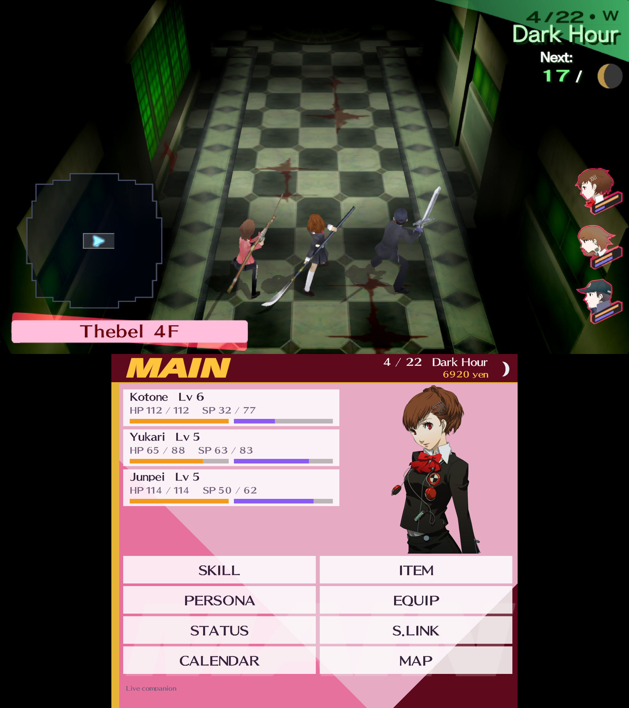 | 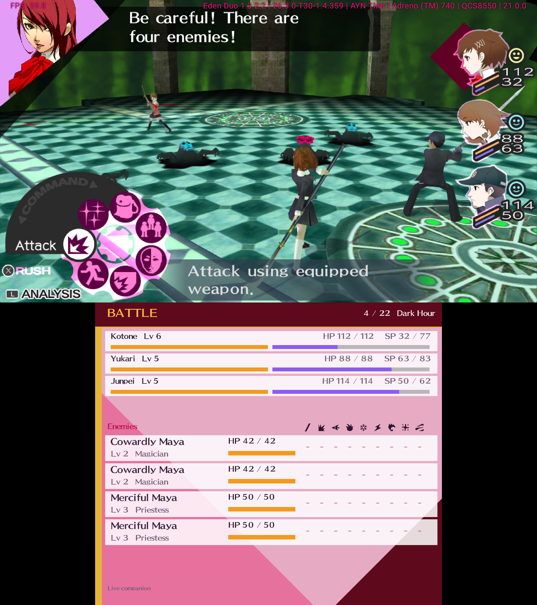 | 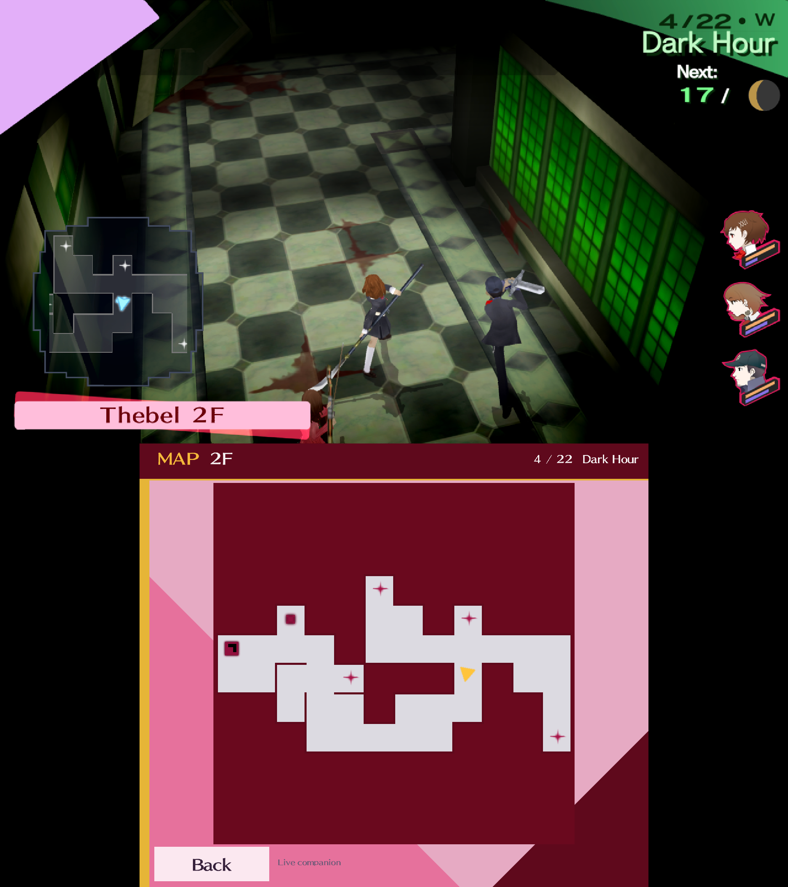 |

| Dialogue | Persona | Social Links |
|:---:|:---:|:---:|
| 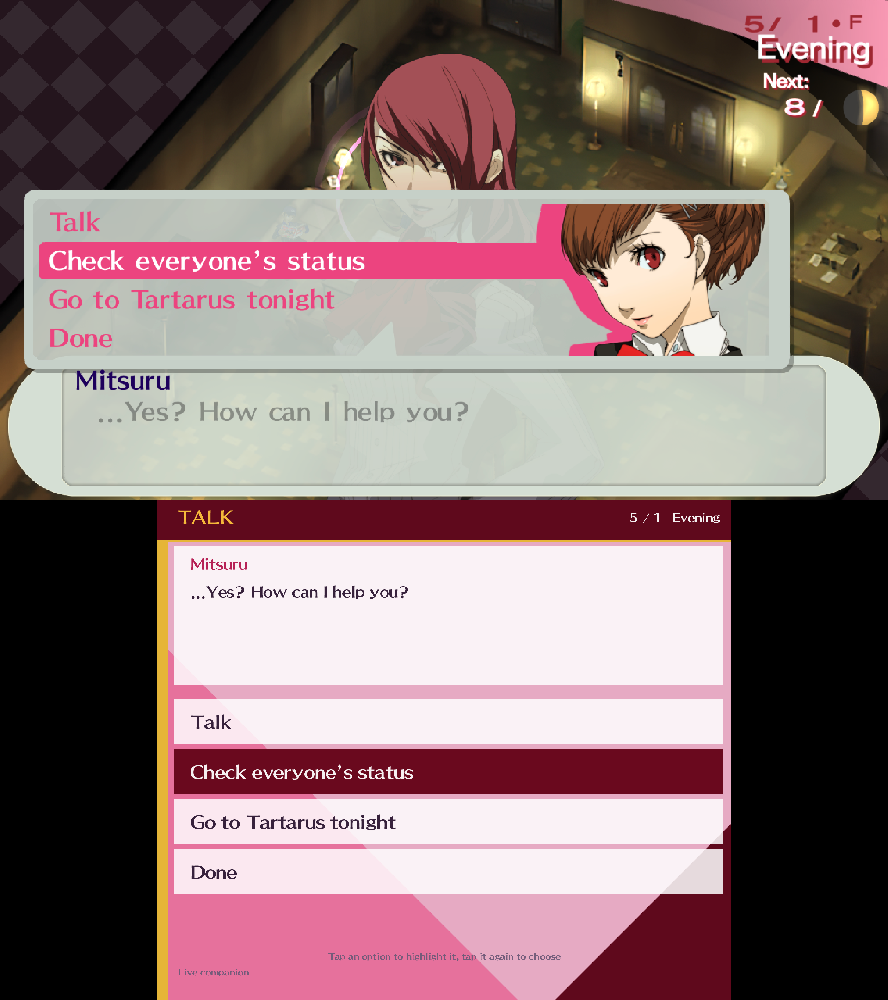 |  |  |

A bottom-screen version of the camp menu, in blue or pink to match the protagonist:

- **Skill, Item, Persona, Equip, Status, S.Link, Calendar.** Laid out like the native camp menu, with the game's own descriptions for items, equipment and skills.
  - Persona shows stats, affinities, skills, skill card and the next skill to learn.
  - S.Link shows each link's rank, its Details line and the members' profiles.
  - Calendar shows holidays, today and full moons.
- **Use items, change equipment and change Persona from the touch screen.** The companion drives the game's own camp menu one button press at a time, then backs out; nothing is written to the game's memory.
- **Battle.** Party HP/SP, ailments and stat changes; enemies with level, arcana, HP and affinities once analyzed. Opens by itself during battles.
- **Tartarus map.** The floor as the game's minimap reveals it, with the party's position and facing, stairs, chests, teleporter and nearby Shadows.
- **Dialogue.** Choice lists in large text with the speaker and current line; tap to highlight, tap again to choose.

The companion ships no game art: menus, fonts, portraits and text are read from your own game files.

Requires Eden Duo 1.2.0 or newer. Contributed by [jschroeder1](https://github.com/jschroeder1).

</details>

---

## Contribute to Another Game

Anyone can write a companion for another game, without rebuilding Eden Duo. Start with [**Contribute to Another Game**](docs/CONTRIBUTE.md): what a companion is, what the runtime offers, the reverse-engineering tools, which documents to read in which order, and how to share your companion.

## Building Packages

| Path | Contents |
|------|----------|
| [`native/`](native/) | Native game modules, shared companion helpers, tests and standalone CMake build. See [`native/README.md`](native/README.md). |
| [`packages/`](packages/) | Package sources, one folder per game: `dualscreen/manifest.json`, the per-build data file `<BUILD16>.json` (one per supported build) and, for Persona 5 Royal, the art recipe table `p5r_art.rec`. |
| [`tools/`](tools/) | `build_release.sh` packages its supported companion targets from the package sources and separately built native modules; companions maintained in separate source trees use their own packaging tools. The page generators for Persona 5 Royal ([`tools/p5r/`](tools/p5r/)), Persona 3 Portable ([`tools/p3p/`](tools/p3p/)), Metroid Dread ([`tools/dread/`](tools/dread/)), Mario Kart 8 Deluxe ([`tools/mk8d/`](tools/mk8d/)) and Super Mario Bros. Wonder ([`tools/wonder/`](tools/wonder/)) are here too. |
| [`docs/`](docs/) | How the companion runtime works, the package format, writing a native module and porting a new game. Start with [`docs/CONTRIBUTE.md`](docs/CONTRIBUTE.md). |
| [`screenshots/`](screenshots/) | Captures of both screens for each game. |

The native modules for Persona 5 Royal, Metroid Dread, Mario Kart 8 Deluxe, Super Mario Bros. Wonder, Animal Crossing: New Horizons, Fire Emblem: Three Houses and The Binding of Isaac are C++ and live in this repository under [`native/modules`](https://github.com/igawa6/eden-duo-companions/tree/main/native/modules). Build them here using [the native build guide](native/README.md), strip them, and pass them to the release script:

```sh
P5R_LINUX_SO=... P5R_ANDROID_SO=... DREAD_LINUX_SO=... DREAD_ANDROID_SO=... \
MK8D_LINUX_SO=... MK8D_ANDROID_SO=... WONDER_LINUX_SO=... WONDER_ANDROID_SO=... \
ACNH_LINUX_SO=... ACNH_ANDROID_SO=... FE3H_LINUX_SO=... FE3H_ANDROID_SO=... \
ISAAC_LINUX_SO=... ISAAC_ANDROID_SO=... tools/build_release.sh dist
```

See [`tools/README.md`](tools/README.md) for the details. Link's Awakening needs no native module.

Everything a companion needs is in this repository: the package source, the native module source, the generators and the documentation. The Eden Duo runtime itself is game-agnostic — it has no title IDs, offsets or game names of its own — so a companion is the only place a game's details live. A companion can be built and run on a desktop with `eden-cli` and its virtual second screen (`--aux-virtual`) before it goes to a device; see [`docs/PORTING_A_GAME.md`](docs/PORTING_A_GAME.md). The maintainer's reverse-engineering notes and working files are not published; the comments in each module state what a value is and how it was derived.

## Reporting Problems

Open an issue and include:

- the game, its version and its title ID;
- the companion version (in **Add-ons**);
- the Eden Duo version;
- the device.

A screenshot of both screens helps.

## Game Assets

Companion packages contain **no game assets**: no art, text, audio or level data. Everything game-specific that a companion shows is read at runtime from the player's own game files and from the running game. Do not upload game files, keys, firmware or ROMs to this repository.

## AI Assistance

These companions were developed with AI assistance. The companion modules, the reverse engineering of each game's data and the package generators were written with an AI coding assistant, then reviewed, tested and verified against each game's own screens.

## License

Companion packages and tools are free software, released under the [GNU General Public License v3.0](LICENSE). They are not affiliated with or endorsed by Nintendo, Atlus, SEGA, Sukeban Games, Ysbryd Games, the CTGP-DX team, or the Eden project. All trademarks belong to their respective owners.
