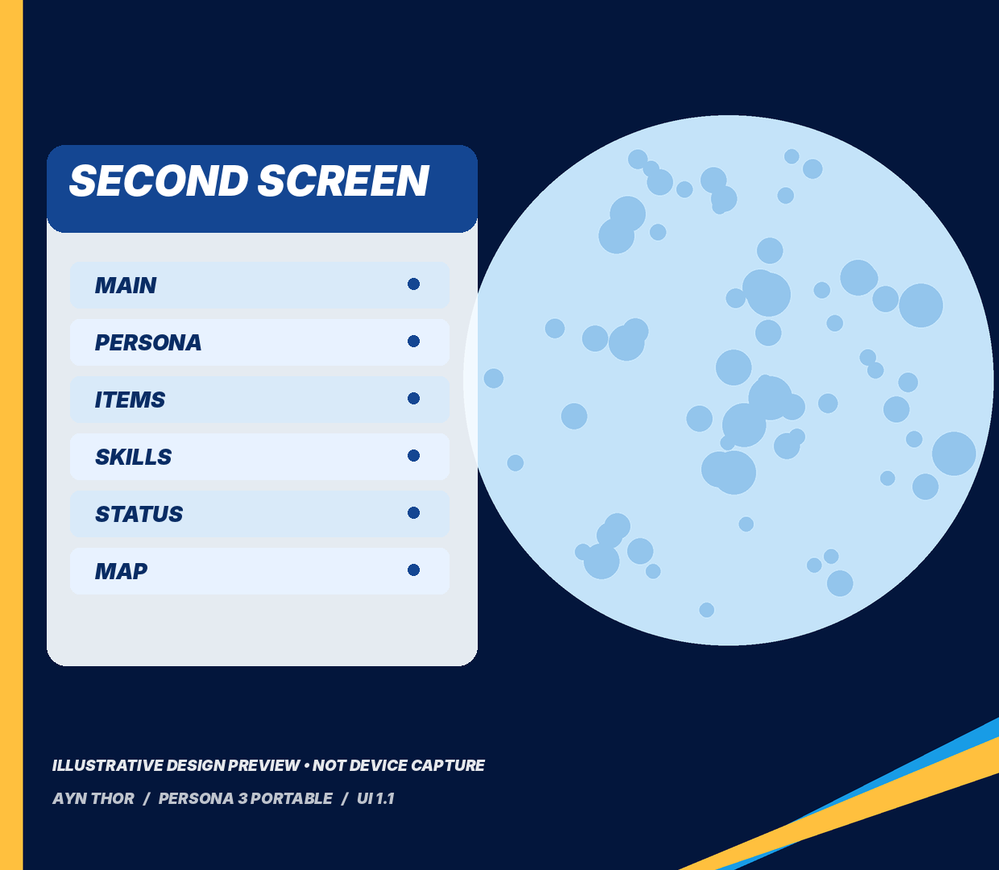
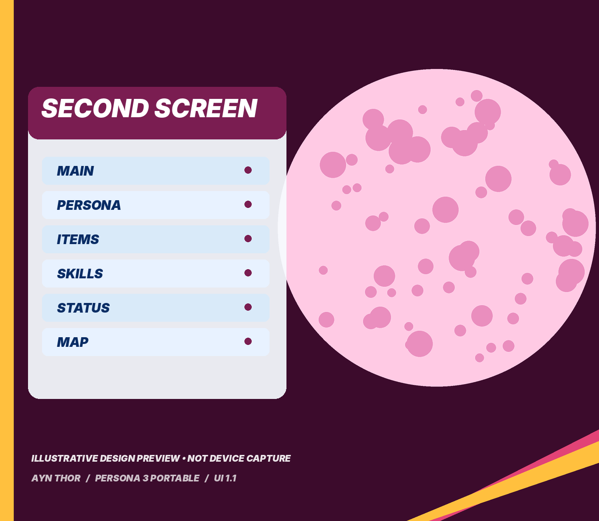

# Persona 3 Portable — AYN Thor second-screen companion

This source package is the proposed **Persona 3 Portable 1.1.0 UI** for
Eden Duo Companions (Switch title ID `0100DCD01525A000`). It replaces the
older second-screen layout when the maintainers approve and merge the update.
It is not an independent game, ROM or mod of game files.

The 12-page layout displays character status, Persona and skill data,
equipment, items, calendar, social links, the map, combat details and talk
choices. Controls use the existing P3P native companion module and its
supported game build. The UI includes male/female route colors, large
touch targets and the original UI artist's custom geometric styling.

## Design previews

These are **illustrative preview composites generated from our own source
artwork**, not screenshots taken from an emulator. Replace them with real
AYN Thor screenshots after the 1.1.0 graphics have passed device QA.





## Source and generation

The single editable manifest source of truth is
[`tools/p3p/layout_v1_1.json`](../../tools/p3p/layout_v1_1.json), a
human-reviewable plain JSON file. The previous P3P layout generator was
retired rather than left as a conflicting second source. Regenerate the
packaged manifest using:

```sh
python3 tools/p3p/gen_manifest.py
```

All **62** included custom PNGs are generated from Pillow source scripts,
not from copied game assets. The original author-developed design's
**55 historic UI assets** have automated exact-file or exact-RGBA checks
against the previously tested 1.8.10 reference. The **other seven** are
new, expressly procedural replacement artwork: two route-specific Start
backgrounds and five plain white title labels. They are **not** represented
as pixel-identical versions of the older 1.8.10 assets and do not reproduce
the game's logo. Their on-device appearance needs renewed review.

```sh
python3 -m pip install "Pillow==12.3.0"
python3 tools/p3p/v1810/prepare_fonts_for_checks.py --output /tmp/p3p-inter
P3P_INTER_FONT_DIR=/tmp/p3p-inter python3 tools/p3p/gen_thor_assets.py
P3P_INTER_FONT_DIR=/tmp/p3p-inter python3 tools/p3p/make_readme_previews.py
```

The font source is the official [Inter](https://github.com/rsms/inter)
release under SIL Open Font License 1.1. Its exact OTF files are downloaded
for local generation with pinned SHA-256 checks. No OTF binaries, game
logos, game graphics, ROMs or keys are shipped in this repository.

## Native module and packaging

The existing Persona 3 Portable native C++ source lives in
`native/modules/0100DCD01525A000.cpp` and its associated reader headers.
It supports the original game's base build
`663052C2C7E8C357BA6EAD36641EE2792397EB1F000000000000000000000000`.
The module reads the player's own game resources at runtime and does not
bundle them. The marker `dualscreen/p3p_font.txt` contains no game font.

Build both native module architectures using the documented
`tools/p3p/README.md` standalone build procedure, strip the resulting
`.so` binaries, then package with the standard Eden Duo packager:

```sh
python3 tools/build_dualscreen_package.py \
  --package packages/Persona3Portable \
  --output dist --version 1.1.0 --min-runtime 19 \
  --build-id 663052C2C7E8C357BA6EAD36641EE2792397EB1F000000000000000000000000 \
  --module linux-x86_64=/path/to/stripped/linux/0100DCD01525A000.so \
  --module android-arm64-v8a=/path/to/stripped/android/0100DCD01525A000.so
```

The packager computes the correct hashes and injects both modules'
metadata into the packaged manifest. The source manifest deliberately
**does not** pin the binary hashes from the older community release.

## Validation status

- Source compiles for Linux x86-64 and Android ARM64 against the pinned
  compatible Eden Duo SDK. Native C++ unit tests passed on Linux.
- The source-built test package based on the older 1.8.10 graphics received
  positive preliminary AYN Thor feedback.
- The *newly generated 1.1.0 replacement graphics* are still awaiting a
  full device screenshot/navigation review; particularly Battle.
- Original visual ownership/provenance and final attribution/license
  approval still require maintainer review before merging.

## Credits

Original P3P companion and source architecture: **jschroeder1**.

Second-screen redesign and device testing: **speerit1**.

The upstream repository and source contributions follow its GPL-3.0
licensing. The independently acquired Inter font binaries remain subject
to the SIL Open Font License.
