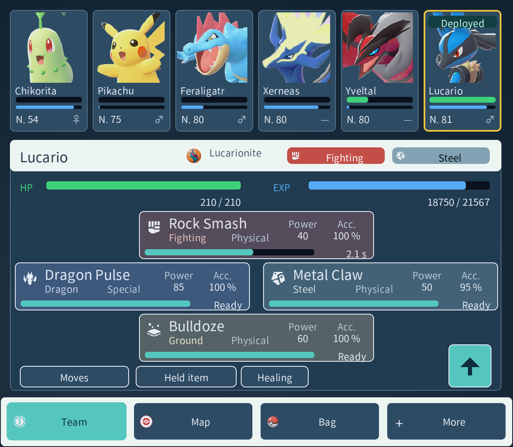
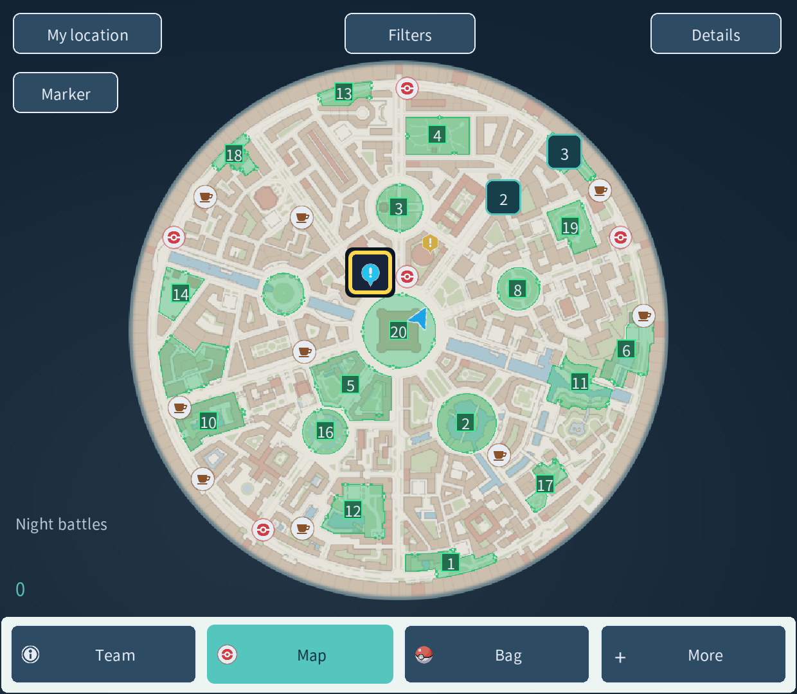

# Pokémon Legends: Z-A Companion 0.38.6

A touch companion for Eden Duo that puts the party, Lumiose map, Pokédex, and other reference screens on a second display. Send out a Pokémon, choose a move, check a mission reward, or look up an encounter while the game remains on the main screen.

| Compatibility | Details |
| --- | --- |
| Game | Pokémon Legends: Z-A **2.0.2**, title ID `0100F43008C44000` |
| Android | **Eden Duo 1.4.0** / companion runtime **25**, arm64. Tested on **Pocket DS**. |

## Features

| Screen | What you can do |
| --- | --- |
| **Team and battle** | Follow the current party and order, HP, experience, levels, types, held items, and the Pokémon on the field. Tap to send out the selected member. Tap a move to aim and attack, with an automatic send-out when a different party member is needed. Move tiles show type, category, power, accuracy, and the in-game recharge gauge when available. |
| **Moves** | Inspect the four equipped moves and browse available level-up moves and compatible owned TMs. Scroll the details pane to read longer descriptions. Replace a party Pokémon’s move directly when the game is ready. Open a boxed Pokémon’s move list for reference. |
| **Pokédex** | Browse Lumiose, Mega Dimension, and Mega Evolution forms in separate catalogs. Select an entry for its portrait, types, description, and collection status. Filter or search by name or number. Open habitats, type matchups, and evolution guides from the entry, or pin it to the Notebook. Mega form status reflects the base species. |
| **Boxes** | Swipe between boxes or use the box picker. Browse portraits, search across storage, and open a Pokémon’s full card with stats, held item, nature, and moves. Choose a party member and confirm a supported direct exchange. |
| **Bag and healing** | Browse item pockets, quantities, artwork, and descriptions. Save up to four favorites. TMs show the move name, stats, and compatible Pokémon. See applicable medicine for a selected party member, use supported HP and status remedies, and equip, replace, or remove a supported held item. Inspect which owned Pokémon can use a supported evolution item. |
| **Lumiose map** | Pan, pinch up to 12× zoom, or recenter on your live position. The player arrow shows the last measured heading. Filter Wild Zones, active nighttime battle zones, Pokémon Centers, cafés, landmarks, active missions, and wild, battle, or unknown Hyperspace Distortions. Tap clustered pins to browse nearby locations. |
| **Map details and actions** | Browse Wild Zone encounters and active distortion details, including stars, level, size, and types where available. Wild distortions can show a scrollable Pokémon list. Place or clear the game’s waypoint so it updates on the minimap, then return automatically from the top-screen map. Request fast travel to enabled Pokémon Centers, Wild Zones, cafés, and other supported landmarks, then confirm in the game. |
| **Missions** | Browse discovered main, extra, and side missions or open the combined **In Progress** list. Completed and available missions appear muted. Read objectives, descriptions, and item and money rewards. Pin a mission or jump to its known map location. The selected mission has a larger icon and high-contrast yellow outline that stays visible among nearby pins. |
| **Progress** | Track Mable’s research level and points, browse the 50 levels and their rewards, and follow Z-A Royale rank, ticket points, and Infinite Z-A Royale where applicable. Also see money and Hyperspace research points. |
| **Notebook and Capture Plan** | Pin Pokémon and missions for quick access. Group capture goals by Wild Zone, see which targets still lack a known location, and jump to an available map location. |
| **Field guides** | Check habitats, evolution requirements and relevant items, and type weaknesses. Combat Aid compares your party’s moves with the selected Pokémon’s weaknesses and highlights ready moves when live battle data is available. |
| **Navigation and languages** | Use swipeable lists, three customizable shortcuts, and the **More** menu to reach the eight main tabs. The interface follows the save language across the game’s ten supported languages. |

## Screenshots

The gallery shows the 0.38.6 interface in English. Example data illustrates live-only controls and map states.

| Team and moves | Lumiose map |
| --- | --- |
|  |  |

## Install on Android

1. Check that the **2.0.2 update** is active for Pokémon Legends: Z-A in Eden Duo.
2. Use the Android archive `0100F43008C44000-PokemonLegendsZA-0.38.6.dsmod.zip`. Keep its filename.
3. Long-press Pokémon Legends: Z-A in the library. Open **Add-ons → Install → Dual screen mods** and select the ZIP.
4. Start the game and load your save. The companion appears on the second screen once gameplay starts.

Installation menu reference: [Eden Duo](https://github.com/igawa6/eden-duo#install).

## In-game availability

- Fast travel depends on what your save has unlocked. The game presents the destination and asks for confirmation.
- Some quest locations become available to the companion after you open the in-game map once. Only missions in progress get map pins when location data is available.
- Direct move edits, Box exchanges, medicine use, and held-item changes require a compatible live game state. If a control is unavailable, return to the city, close the game menus, and recall the Pokémon on the field.
- Boxed Pokémon moves are available for inspection. Direct move replacement is supported for party Pokémon.

## Credits and feedback

Community companion by Sickops, built for igawa6’s Eden Duo. Pokémon artwork and game text are read at runtime from the player’s own game files. The package includes generated interface graphics and the Noto Sans CJK font under the SIL Open Font License. Source credits include PKHeX and SysBot.NET. The project is independent and uses GPL-3.0-or-later source.

For a bug report, include your device, Eden Duo version, game update, companion version, and the steps to reproduce it. Screenshots of both displays help.

To build the Android archive, see [the Z-A build guide](../../tools/za/README.md).
